# 取扱説明書
{: id="取扱説明書"}

陸上競技の記録を管理するアプリの使い方。**第 1 部は自分の記録だけを管理するとき、第 2 部はチームで記録を管理するとき**の操作を、使う順に並べる。
チームで使うときも、記録の入れ方などの共通の画面は第 1 部を見る。

- **スクショのデータはすべて架空**（選手A・架空中学 陸上部など）

## 目次
{: id="目次"}

0. [アプリを入れる（テスト中）](#0-アプリを入れるテスト中)

**[第 1 部 個人で記録を管理する](#第-1-部-個人で記録を管理する)**

1. [はじめに（初回起動）](#1-はじめに初回起動)
2. [記録の一覧（最初の画面）](#2-記録の一覧最初の画面)
3. [記録を登録・修正](#3-記録を登録修正)
4. [自己ベスト](#4-自己ベスト)
5. [大会の一覧](#5-大会の一覧)
6. [追加種目](#6-追加種目)
7. [PCで編集（CSV）](#7-pcで編集csv)
8. [設定](#8-設定)

**[第 2 部 チームで記録を管理する](#第-2-部-チームで記録を管理する)**

9. [チームでの記録のやり取り](#9-チームでの記録のやり取り)
10. [チーム一覧とチームの画面](#10-チーム一覧とチームの画面)
11. [管理者の操作（チームを作って記録をまとめる）](#11-管理者の操作チームを作って記録をまとめる)
12. [部員の操作（チームに入って記録を送る）](#12-部員の操作チームに入って記録を送る)
13. [チームを戻す・削除する](#13-チームを戻す削除する)

---

## 0. アプリを入れる（テスト中）
{: id="0-アプリを入れるテスト中"}

ストアに出すまでは、APK のファイルを受け取って入れる。2 種類あり、**並べて入れられる**（記録は別々）。

| | 端末に出る名前 | 使いどころ |
|---|---|---|
| テスト版 | 陸上競技部 記録管理 | ふだん使う形。Standard の機能（チームデータを配布など）を全部試せる |
| 開発版 | 陸上競技部 記録管理（開発版） | アイコンの下に赤い「DEV」の帯がある。動きは遅い。［設定］の［グレード（開発用に切り替えられる）］で Free と Standard を切り替えて、Free の制限を試せる（**切り替えは残らず、アプリを起動し直すと Free に戻る**） |

1. 受け取った APK（`taf-test-….apk`・`taf-dev-….apk`）を、Google ドライブやメールからスマホで開く
2. 「この提供元のアプリはインストールできません」と出たら、［設定］で開いたアプリ（ドライブ・Chrome・ファイルなど）の
   **「この提供元を許可」**をオンにして戻る
3. ［インストール］。Google Play プロテクトの警告が出たら［詳細］→［このままインストール］

- **新しい APK は、同じ種類のものを上から入れれば記録は残る**（消してから入れ直すと記録も消える）
- **アプリの作り手から「入れ直しが要る」と知らされたときは、上から入れられない。** 先に［設定］の［端末のバックアップ］で書き出し、消して入れ直してから戻す（→ [端末のバックアップ](#端末のバックアップ)）
- テスト中はデータの形が変わることがあり、更新したあとに「記録を読めません」と出たら、端末の［設定］→［アプリ］→
  このアプリ →［ストレージ］→［データを削除］で作り直す

---

# 第 1 部 個人で記録を管理する
{: id="第-1-部-個人で記録を管理する"}

自分の記録を入れて、自己ベストを見る。チームに入らなくても、この部だけで使える。

## 1. はじめに（初回起動）
{: id="1-はじめに初回起動"}

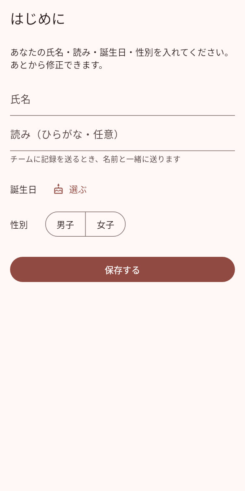

初めて開くと、まず自分の**氏名・読み・誕生日・性別**を入れる。このアプリの記録は自分の分だけを入れる
（チームの記録はチームの画面で入れる。[第 2 部](#第-2-部-チームで記録を管理する)）。

- 読み（ひらがな）は入れなくてもよい。チームに記録を送るとき、名前と一緒に送られ、管理者の部員の一覧で五十音順に並ぶのに使われる。カタカナで入れるとひらがなになる
- 誕生日は［選ぶ］でカレンダーを開き、年から選ぶ
- 足りない欄があると、［保存する］で警告の画面に並ぶ
- あとから［設定］→［プロフィール］で修正できる

## 2. 記録の一覧（最初の画面）
{: id="2-記録の一覧最初の画面"}

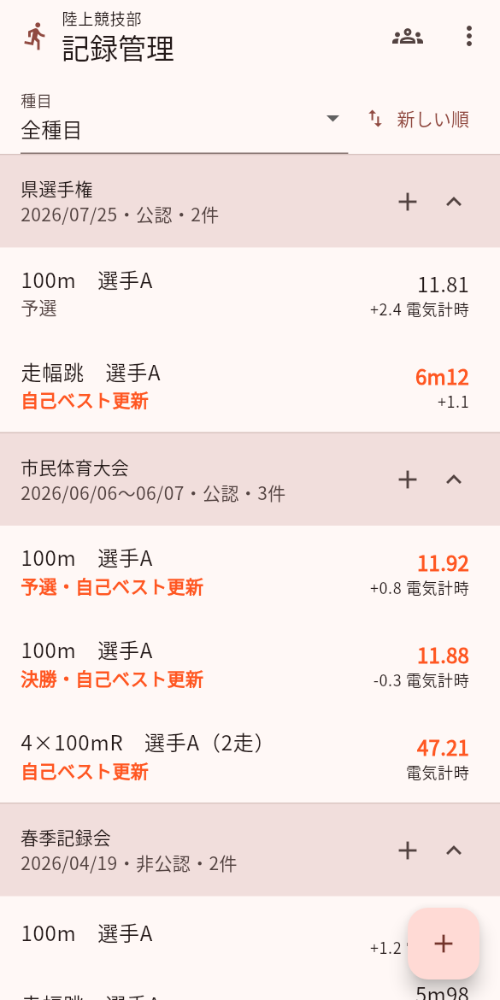

左上はアプリの名前（**陸上競技部 記録管理**。走る人の印と 2 段で出る）。

- 記録は**大会ごとにまとまり、時系列に並ぶ**。右上の［新しい順］を押すと［古い順］に切り替わる
- **大会の見出しを押すと、その大会を閉じる・開く**。見出しの［＋］で、その大会を選んだ状態で記録を入れ始める
- ［種目］で、ひとつの種目の記録だけに絞り込める
- 大会の中は種目の並び順（設定で変えられる）。同じ種目はラウンドの順（予選 → 決勝）
- **自己ベストを更新した記録は、値が橙の太字**になり「自己ベスト更新」と出る
- 行を押すと、その記録を修正する画面が開く。右下の［＋］で新しい記録を登録

右上は［人たち］（[チーム一覧](#10-チーム一覧とチームの画面)）と「︙」。「︙」を押すと、上から次が出る。

| メニュー | 開く画面 |
|---|---|
| 自己ベスト | [4 章](#4-自己ベスト) |
| 大会 | [5 章](#5-大会の一覧) |
| 追加種目 | [6 章](#6-追加種目) |
| PCで編集（CSV） | [7 章](#7-pcで編集csv) |
| 設定 | [8 章](#8-設定) |

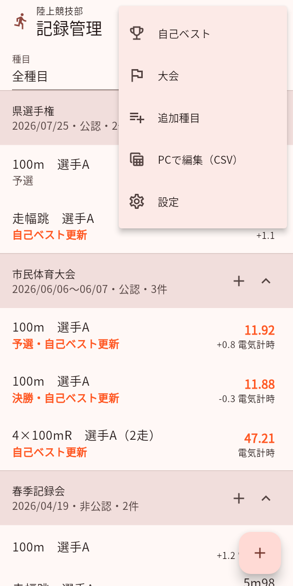

チームの画面では、大会・追加種目・PCで編集（CSV）が「︙」→［チームの設定］の中にある（[10 章](#チームの設定)）。

## 3. 記録を登録・修正
{: id="3-記録を登録修正"}

 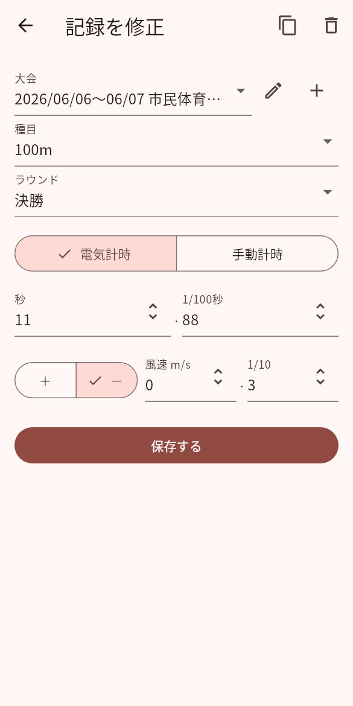

上から順に選ぶ・入れる。

1. **大会**を選ぶ。無ければ右の［＋］でその場で追加できる（名前・開始日・終了日・場所・種類）。選んだ大会は鉛筆のボタンで修正できる
2. **種目**を選ぶ。リレー・駅伝なら、自分の走順・区間も選ぶ（ほかの走者は入れない）
3. **ラウンド**（なし・予選・2次予選・3次予選・準決・決勝）
4. **記録**を単位ごとの欄に入れる（`11`［秒］`88`［1/100 秒］、`6`［m］`12`［cm］）。数字キーか、欄の右の上下のボタン（ドラム）で入れる。範囲の外の数字は打てない
5. 時間の種目は［電気計時］／［手動計時］を選ぶ。風速を測る種目は、［＋］／［－］と風速（m/s・1/10）を入れる
6. ［保存する］

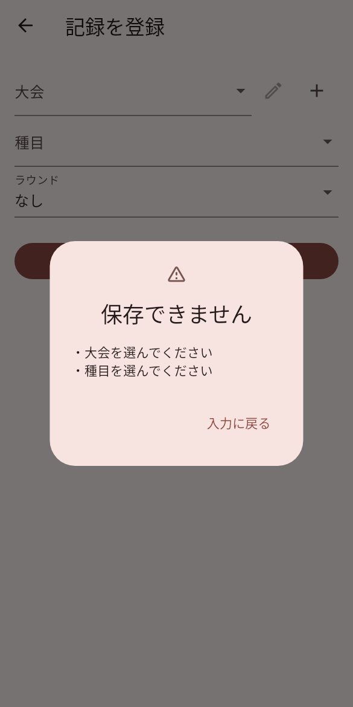

入力に足りないところがあると、［保存する］で**「保存できません」の画面に足りないところがまとめて出る**（保存しない）。
［入力に戻る］で、入れたものはそのまま戻る。保存できたら「保存しました」の画面が出て、閉じると一覧へ戻る。

**修正するとき**（一覧の行を押す）は、欄に今の値が入って開く。右上のごみ箱で、確かめてから削除できる。

### コピーして登録
{: id="コピーして登録"}

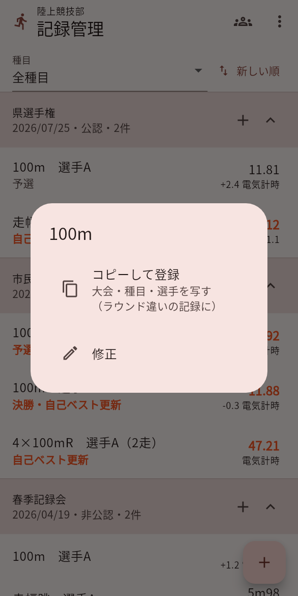 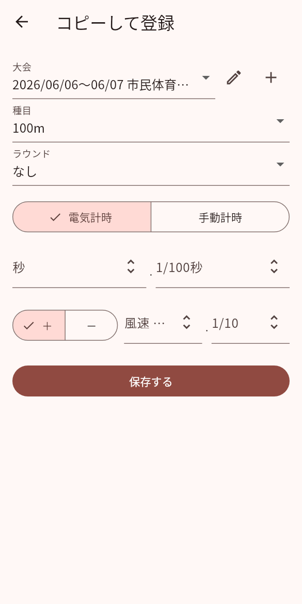

**同じ大会・同じ種目で、ラウンド違いの記録（予選と決勝など）を入れるとき**に使う。

- 一覧の行を**長押し**して［コピーして登録］を選ぶ。または、修正する画面の右上のコピーのボタン（ごみ箱の左）
- 大会・種目・計時の方式（リレー・駅伝は自分の走順・区間、チームの記録は選手・走者）が入った「コピーして登録」画面が開く。
  **記録・風速・ラウンドは空**なので、ラウンドと記録を登録して［保存する］
- 新しい記録として 1 件増える（元の記録は変わらない）。修正する画面から開いたときは、保存すると一覧へ戻る
- 長押しのメニューの［修正］は、行を押したときと同じ

## 4. 自己ベスト
{: id="4-自己ベスト"}

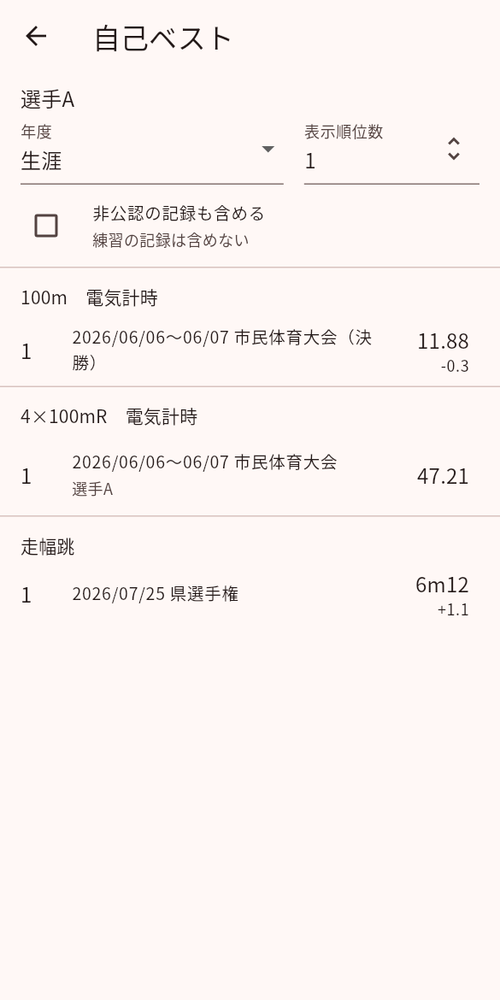

記録の一覧の右上の「︙」→［自己ベスト］で開く。

- 種目ごと（時間の種目は電気計時と手動計時を別に）に、良い順で出る
- ［年度］: 既定は［生涯］。年度は 4月〜翌3月
- ［表示順位数］: 何位まで出すか（既定は 1）
- ［非公認の記録も含める］: 既定は公認の大会の記録だけ。練習の記録はどちらでも入らない
- 追い風参考（+2.0 m/s を超える）と、風速を測る種目で風速を入れていない記録は入らない
  （上の一覧の県選手権の 100m・+2.4 が、自己ベストに入っていない）

## 5. 大会の一覧
{: id="5-大会の一覧"}

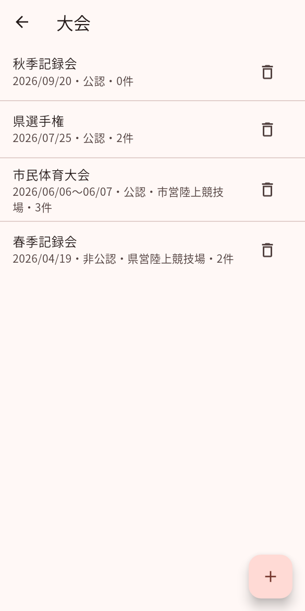 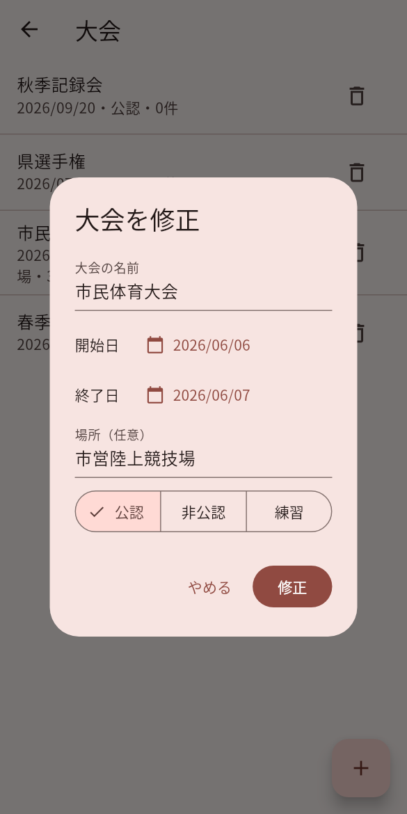

記録の一覧の右上の「︙」→［大会］で開く（チームの画面では、右上の「︙」→［チームの設定］→［大会］）。大会を**管理する**画面（記録は出さない。記録を大会ごとに見るのは記録の一覧）。

- 記録の無い大会も含めて、開始日の新しい順に並ぶ。行は日付・種類・場所・記録の件数
- 右下の［＋］で大会を追加。**行を押すと大会を修正する**（名前・開始日・終了日・場所・種類）
  - 1日の大会は終了日を触らなくてよい。2日以上の大会だけ［終了日］を動かす
  - 種類は公認／非公認／練習（公認の記録会は公認）
- **行を長押しして［コピーして追加］を選ぶと、大会を写して新しく追加できる**（記録の行の長押しと同じ使い方）。前年度と同じ大会を、コピーして日付だけ修正するときに使う。
  名前・開始日・終了日・場所・種類が入った「大会をコピーして追加」が開くので、日付（と名前）を修正して［追加］。元の大会は変わらない。長押しのメニューの［修正］は、行を押したときと同じ
- 行のごみ箱で大会を削除

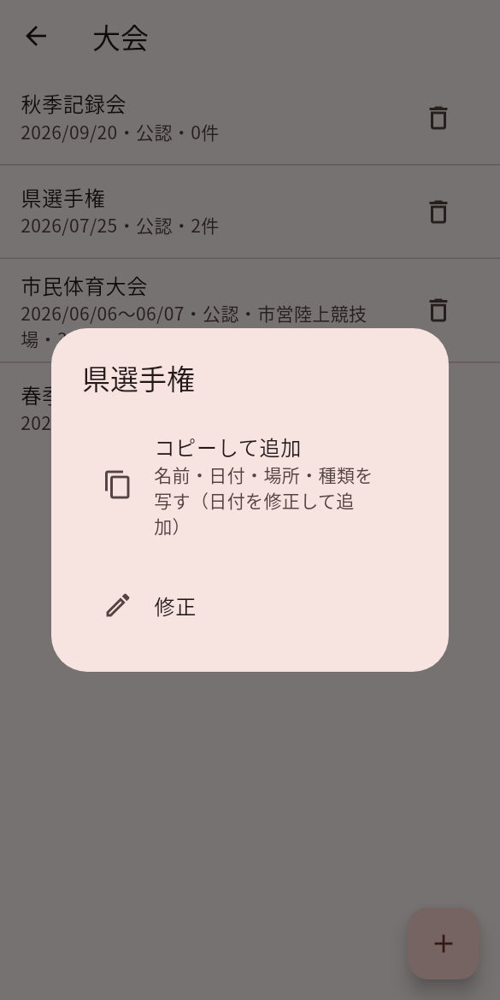 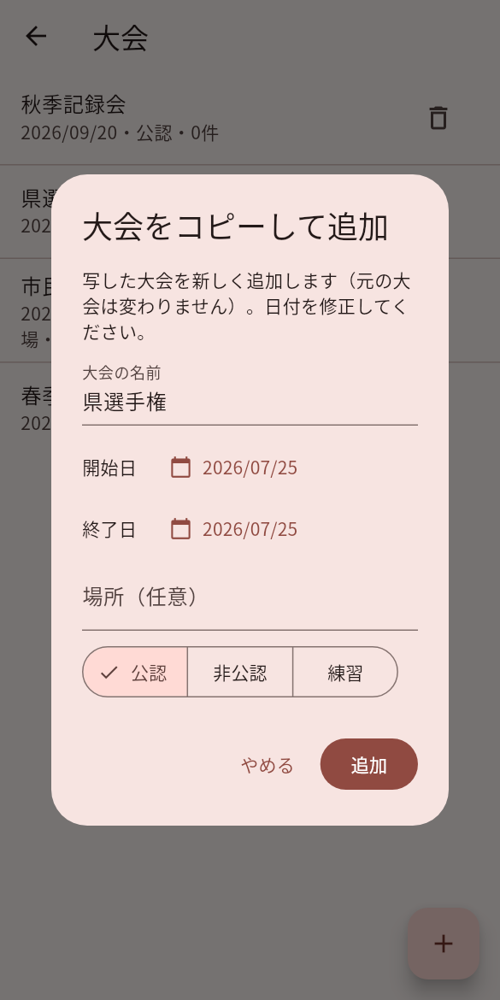

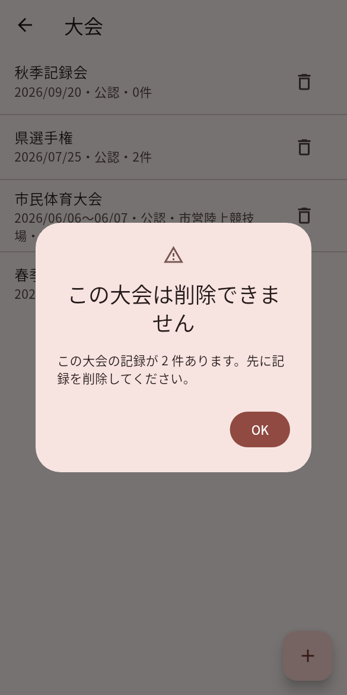

**記録のある大会は削除できない。** 件数が出るので、先に記録を削除。記録の無い大会は、確かめてから消える。

## 6. 追加種目
{: id="6-追加種目"}

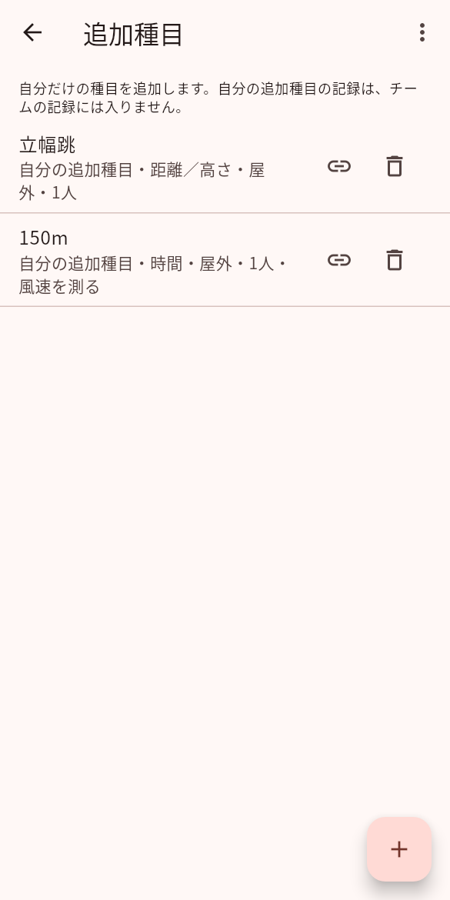 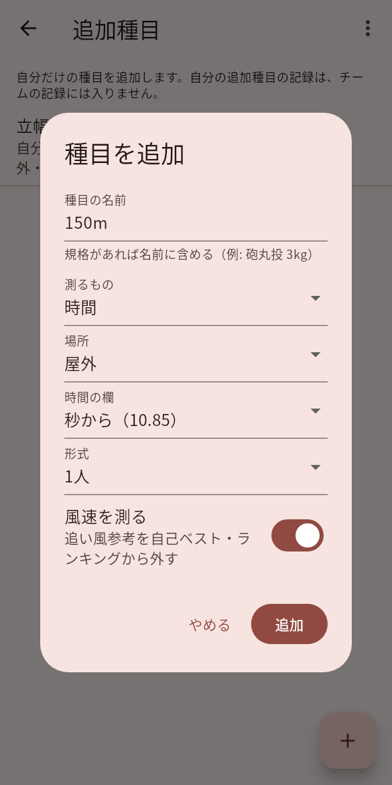

記録の一覧の右上の「︙」→［追加種目］で開く。標準の一覧に無い種目（150m・立幅跳など）を追加。追加した種目は、記録の入力・一覧・自己ベスト・種目の並び順に、
標準の種目と同じように出る。**自分の追加種目の記録は、チームの記録には入らない。**

- ［＋］で追加。欄は**種目の名前・測るもの（時間、距離／高さ、得点）・場所（屋外／室内／ロード）・時間の欄
  （秒から／分から／時から）・形式（1人／リレーと走者の数）・風速を測るか**。選べない組み合わせは出ない
  （ロードとリレーは時間の種目だけ。風速は屋外の時間・距離の種目だけ。ロードは時から）
- **規格（重さ・高さ）は名前に含める**（例: 砲丸投 3kg）。駅伝は追加できない（標準の駅伝を使う）
- **標準の種目やほかの追加した種目と同じ名前では追加できない**（「同じ名前の種目があります」と出て［追加］を押せない）
- 行を押すと修正。**記録のある種目は名前と時間の欄だけ修正できる**（測るものなどを変えると、入れた記録の意味が変わるため。時間の欄は入力の欄の出し方だけ）
- ごみ箱で削除。**記録のある種目は削除できない**（先に記録を削除）
- チームから受け取ったチームの追加種目も「チームの追加種目」として並ぶ（修正できない）

### 種目を書き出す・読み込む（アドオン）
{: id="種目を書き出す読み込むアドオン"}

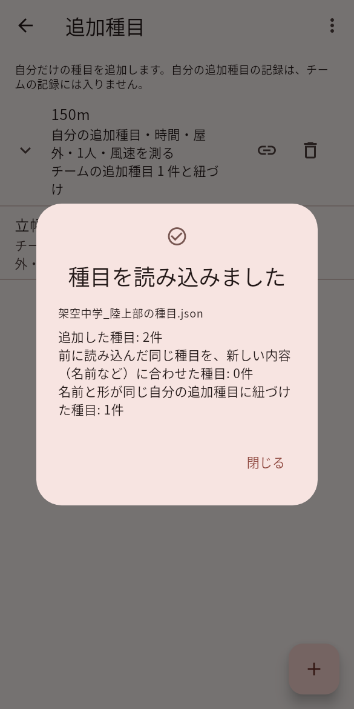

右上の「︙」で［種目を書き出す］［種目を読み込む］。追加した種目の定義だけ（記録は入らない）を 1 つのファイル（`.json`）にする。

- ［種目を書き出す］: スマホの共有の画面が開くので、送り先（メール・SNS・ファイルに保存）を選ぶ。**Standard だけ**（Free では「種目を書き出すには Standard が要ります」）。機種を替えるときは「端末のバックアップ」（[8 章](#端末のバックアップ)）でも種目が移る
- ［種目を読み込む］: 受け取ったファイルを選ぶ（Free でもできる）。読み込んだ結果に、次の数が出る
  - **追加した種目**: この端末に無かった種目
  - **前に読み込んだ同じ種目を、新しい内容に合わせた種目**: 前に読み込んだのと**同じ種目**（同じアドオン・同じチームの種目）で、管理者が名前などを修正したもの。端末の種目もその名前になる。**名前が同じだけの別の種目は、ここには入らない**
  - **名前と形が同じ自分の追加種目に紐づけた種目**: **初めて届いた**チームの追加種目と、**名前も形（測るもの・場所・形式・走者の数・風速）も同じ**自分の追加種目があれば、自動で紐づける（下の「チームの追加種目を紐づける」。同じ種目が 2 つ並ばない）。前から端末にある種目は自動では紐づけないので、［紐づけを外す］で外したものは、読み込み直しても外したまま
  - **「ほかの種目と名前が同じです」**: 名前は同じでも**形が違う**ので紐づけられなかった種目（例: 自分の「150m」は風速を測らない、チームの「150m」は測る）。どちらも入ってはいるので、見分けられるよう**自分の追加種目の名前を修正する**（チームの追加種目は修正できない）
  - 記録があって形が違う種目は合わせない。種目のファイルでなければ「種目を読み込めません」と出る
- チームの画面の「追加種目」でも同じ（編集モードのときだけ）。管理者はチームの追加種目を書き出して部員へ配る

### チームの追加種目を紐づける
{: id="チームの追加種目を紐づける"}

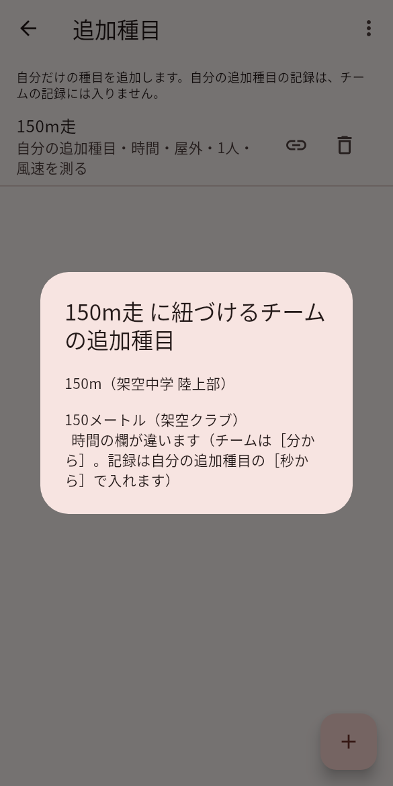 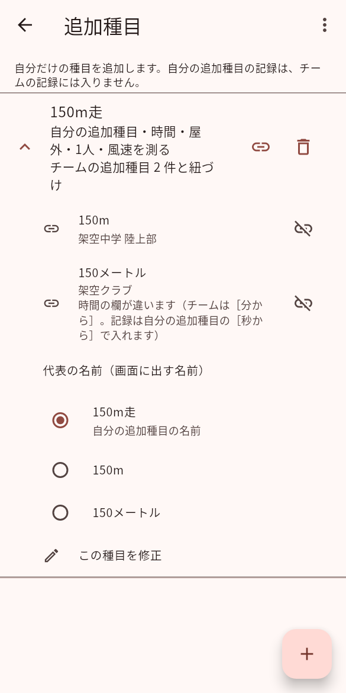

チーム A の「150m」、チーム B の「150メートル」、自分の「150m走」のように、**名前は違っても同じ種目なら、自分の追加種目にまとめて扱える。**
紐づけるのは**自分の追加種目とチームの追加種目だけ**（標準の種目は対象にしない）。

- 自分の追加種目の行の鎖のボタン →［チームの追加種目を紐づける］で、同じ種目を選ぶ。**この端末にあるチームで追加された種目**（チーム名が付く）が出る
  （形＝測るもの・場所・形式・走者の数・風速が同じ種目だけ選べる。違う種目は「走者の数が違うので紐づけられません」のように理由が出て、押せない）。
  1 つの自分の追加種目に、いくつものチームの追加種目を紐づけられる
- **時間の欄（秒から／分から）が違っても紐づけられる。** 違いは候補と一覧の行に「時間の欄が違います（…記録は自分の追加種目の［分から］で入れます）」と出る
- 紐づけたチームの追加種目は記録の入力・一覧・自己ベストに出ず、**記録は自分の追加種目の記録としてまとまる**（チームの追加種目で入れた記録も一緒に自己ベストを出す）
- 紐づけたあとは**自分の追加種目の行だけ**が出る（「チームの追加種目 2 件と紐づけ」）。**行を押すと開いて**、紐づけた種目（チーム名・時間の欄の違い）が並ぶ。
  種目の右のボタンで紐づけを外す。鎖のボタンの［紐づけをすべて外す］でまとめて外す
- 開いた中の［代表の名前］で、画面に出す名前を、自分の追加種目の名前と紐づけた種目の名前から選べる。**選んでも自分の追加種目の名前は変わらない**（「自分の追加種目の名前: …」と出る。自分の名前を選び直せば戻る）
- 修正するのは開いた中の［この種目を修正］。紐づけていても、名前と時間の欄は修正できる
- 自分の追加種目を削除すると、紐づけたチームの追加種目は紐づけが外れて戻る
- 紐づけた種目は名前だけ修正できる。チームの種目は変わらない

## 7. PCで編集（CSV）
{: id="7-pcで編集csv"}

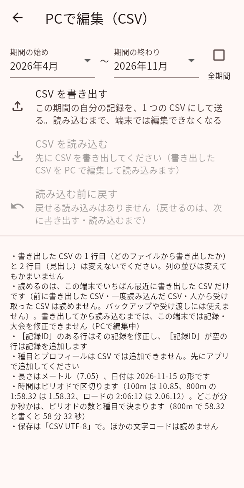 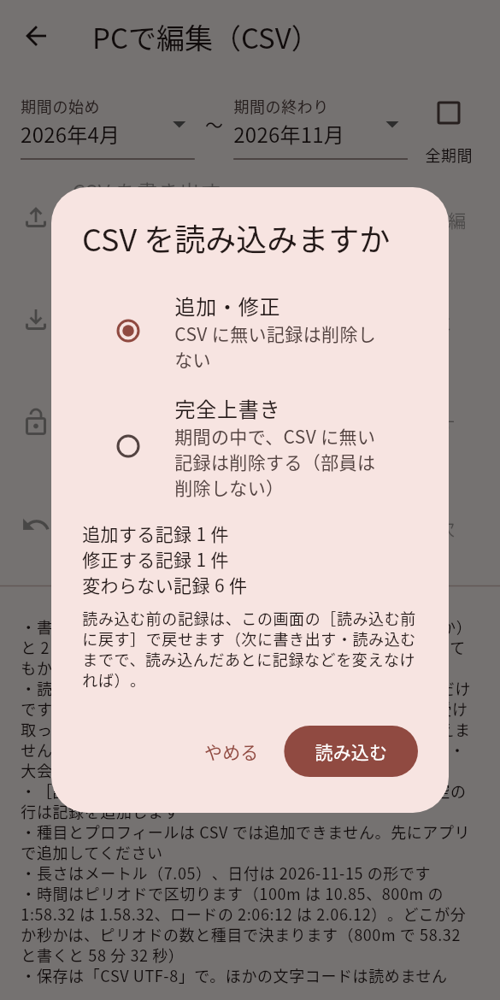 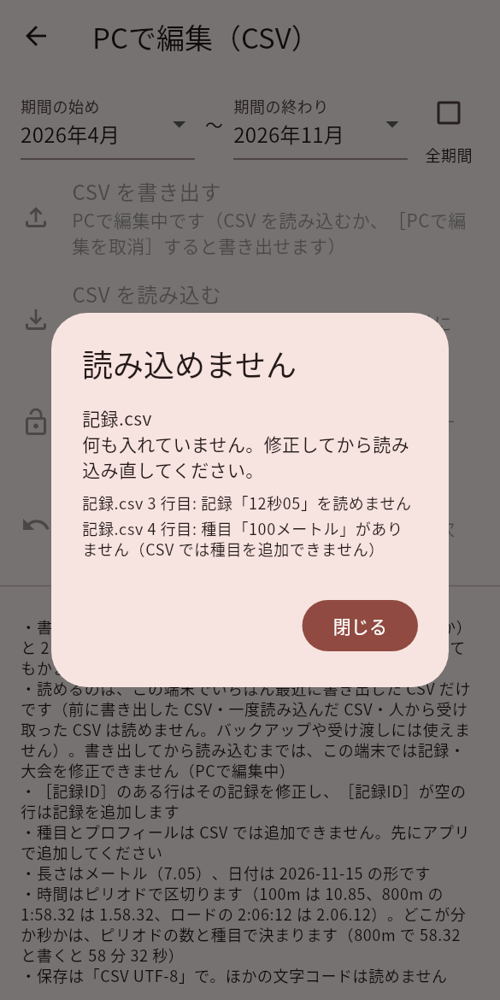 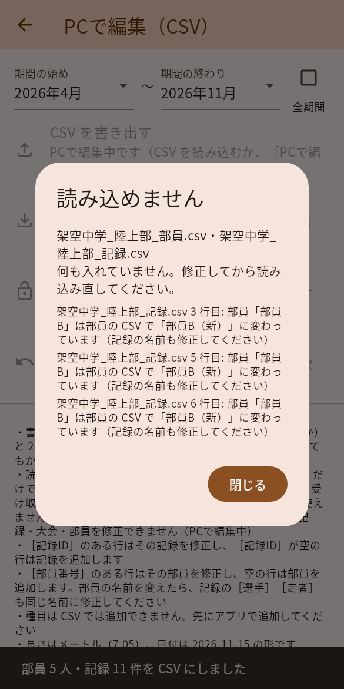

記録を **CSV**（表計算のソフトで開けるファイル）にして、**PC でまとめて修正し、アプリへ読み込む**ためのもの。大会の名前の打ち間違いを一度に修正、紙で控えた記録をPC で打ってまとめて入れる、といった使い方を想定している。

- 自分の記録: 記録の一覧の右上の「︙」→［PCで編集（CSV）］
- チームの記録: チームの画面の「︙」→［チームの設定］→［PCで編集（CSV）］。**編集モードのときだけ出る**（[11 章](#編集モード)）。**部員の名簿の CSV と記録の CSV の 2 つをセットで**扱う。**Free ではチームの記録を書き出せない**（[8 章「グレード」](#グレード)）

### PCで編集中
{: id="pcで編集中"}

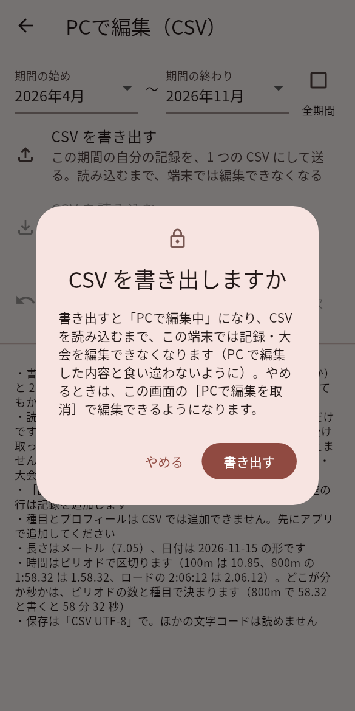 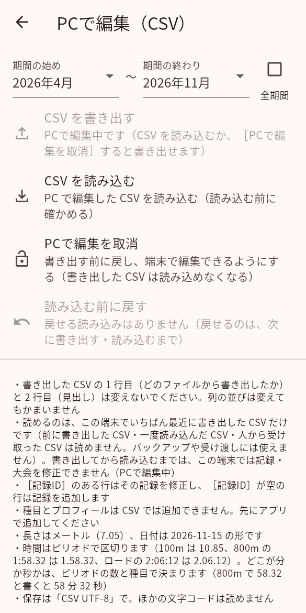 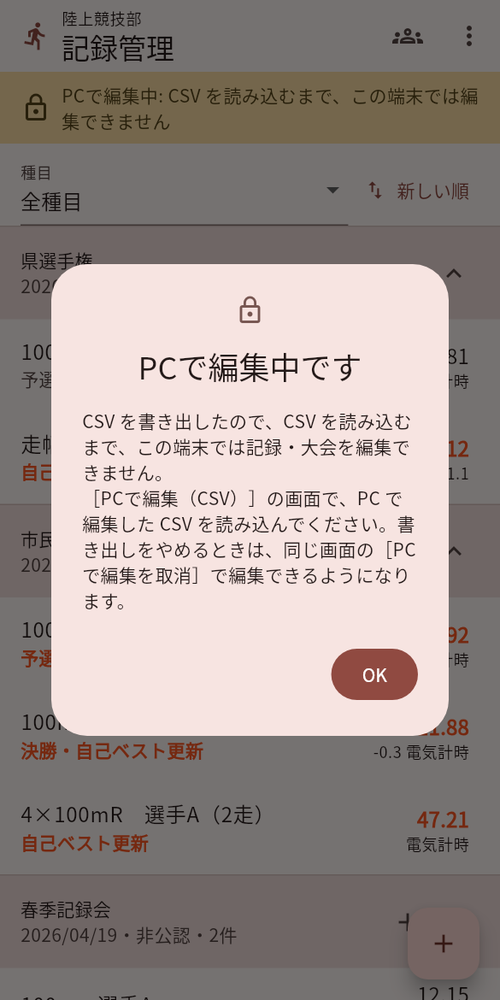

**CSV を書き出すと「PCで編集中」になり、CSV を読み込むまで、この端末では記録・大会（チームは部員も）を編集できない。** PC で編集している間に端末でも修正すると、どちらが正しいのか分からなくなるため。書き出す前に、そのことを知らせる画面が出る。

| 状態 | ［CSV を書き出す］ | ［CSV を読み込む］ | 端末での編集 |
|---|---|---|---|
| ふだん（書き出す前） | できる | できない（先に書き出す） | できる |
| **PCで編集中**（書き出したあと） | できない | できる | **できない**（記録の一覧の上に帯が出る。登録・修正・削除しようとすると「PCで編集中です」と出る） |

- 読み込むと、ふだんの状態に戻る
- **書き出しをやめるときは［PCで編集を取消］**（PCで編集中だけ出る）。確かめてから、ふだんの状態に戻る。**書き出した CSV は読み込めなくなる**（PC で編集した内容は入らない）
- 状態は個人とチームごとに別（チーム A を PCで編集中でも、自分の記録やチーム B は編集できる）
- 追加種目・プロフィールは CSV に入らないので、PCで編集中でも修正できる
- PCで編集中のチームのデータを取り込もうとすると、書き出した CSV が読み込めなくなることを先に知らせる

### 流れ
{: id="流れ"}

1. 上の**期間**（年月〜年月。大会の開始日で選ぶ。初めは今年度）を選び、［CSV を書き出す］→［書き出す］で、その期間の記録が入った CSV ができ（**PCで編集中になる**）、スマホの共有の画面が開く（自分の記録は `記録.csv`。チームは `<チーム名>_部員.csv` と `<チーム名>_記録.csv` の **2 つが一緒に**送られる）。メールなどで自分のパソコンへ送る
2. PC で開いて修正（下の「CSV の形」「PCで編集するときの注意」）
3. 修正した CSV をスマホへ戻し、［CSV を読み込む］で選ぶ。**チームは部員の CSV と記録の CSV を一緒に選ぶ**（どちらか一方だけでもよい。ファイルの名前は変えてもよく、見出しでどちらかを見分ける）
4. アプリが**全部の行を確かめる**。合わない行が 1 つでもあると「読み込めません」と**ファイル名・行番号と理由**が出て、**何も入らない**。CSV を修正して、もう一度読み込む
5. すべて合えば「CSV を読み込みますか」に**読み込み方**と件数（追加する・修正する・変わらない・削除する記録、追加する・修正する大会と部員）が出る。［読み込む］で入る

| 読み込み方 | 何が起きるか |
|---|---|
| **追加・修正**（はじめの選択） | ［記録ID］のある行はその記録を修正し、［記録ID］が空の行は記録を追加する。**CSV から削除した行の記録は削除されない**（削除はアプリで） |
| **完全上書き** | **期間を選び**、その期間の行で追加・修正し、**その期間の記録のうち CSV に無いものを削除する**（PC で削除した行も消える）。期間の初めは**書き出したときの期間**。**期間の外の記録は残る**（今年度だけ書き出して修正した CSV で、去年までの記録が消えない）。［全期間］に印を付けると、CSV に無い記録はすべて削除する |

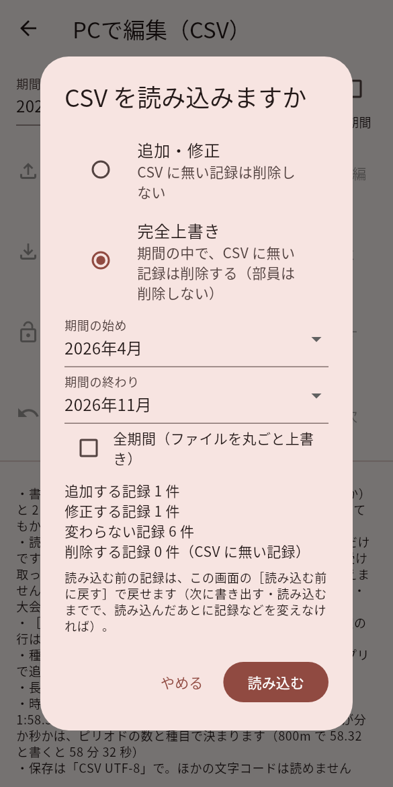

- 書き出すときの［全期間］に印を付けると、期間に関わらずすべての記録を書き出す
- **削除する記録があるときは、読み込む前に「記録 N 件を削除します」と確かめる**（［やめる］なら何も変わらない）
- **間違えて読み込んだら、この画面の［読み込む前に戻す］で戻せる**（どちらの読み込み方でも）。戻せるのは直前の 1 回分で、**次に書き出す・読み込むまで**。**読み込んだあとにアプリで記録・大会・種目・部員を追加したり直したりしていたら、戻せない**（「読み込む前に戻せません」と出る）
- 部員の CSV は、どちらの読み込み方でも**［部員番号］のある行はその部員を修正し、空の行は部員を追加する。部員は削除されない**（部員の CSV から削除しても残る。卒業・退部した部員は［所属］を `所属外` にする）
- 部員の CSV だけを選んだときは、記録は変わらない（読み込み方も出ない）

### CSV の形
{: id="csv-の形"}

**1 行目はどのファイルから書き出したか**（アプリが書く）、**2 行目が見出し**、3 行目から 1 行に記録 1 件。文字コードは UTF-8。**見出しの名前で列を読む**ので、列の並びは入れ替えてよく、メモの列を追加してもよい（読まない）。1 行目と見出しの名前は変えない。

- **CSV は、この端末で書き出して、PC で修正し、同じ端末へ読み戻すためのもの。読めるのは、いちばん最近に書き出した CSV だけ。** 書き出して送るたびに、前に書き出した CSV は読めなくなる（共有の画面を閉じて送らなかったときは、前の CSV もそのまま読める）。読み込んだ CSV も、もう一度は読めない（直し足りなければ、書き出し直してから修正）
- 別のチームの CSV・人から受け取った CSV・チームのデータを取り込み直す（端末のバックアップから戻す）前に書き出した CSV は、「ほかのチーム「…」の CSV です」「いまのデータから書き出した CSV ではありません」と出て、何も入らない。1 行目を削除した CSV も読まない
- **バックアップや受け渡しには使えない**（チームデータを配布・端末のバックアップを使う）

自分の記録の例:

```csv
TaF-RecordsManager の CSV,個人,（自分の ID）,氏名,架空 花子,書き出した日時,2026-11-16 09:30
記録ID,大会,開始日,終了日,場所,大会の種類,種目,種目の符号,ラウンド,走順,記録,風速,計時
12,春季記録会,2026-04-26,,架空競技場,公認,100m,100m,予選,,12.31,+1.2,電気
13,春季記録会,2026-04-26,,架空競技場,公認,走幅跳,LJ,,,5.02,-0.4,
14,市民体育大会,2026-05-16,2026-05-17,,公認,4×100mR,4x100mR,決勝,3,51.20,,電気
,夏季大会,2026-07-20,,,非公認,800m,,,,2.21.40,,電気
```

チームの記録の例（［走順］の代わりに［選手］［走者］。名前は部員の CSV の［名前］と同じにする）:

```csv
TaF-RecordsManager の CSV,チーム,（チームの ID）,管理者,（管理者の ID）,チーム名,架空中学 陸上部,書き出した日時,2026-11-16 09:30
記録ID,大会,開始日,終了日,場所,大会の種類,種目,種目の符号,ラウンド,選手,走者,記録,風速,計時
5,地区大会,2026-06-07,,,公認,100m,100m,決勝,架空 一郎,,11.85,+0.8,電気
6,地区大会,2026-06-07,,,公認,4×100mR,4x100mR,決勝,,架空 一郎／架空 二郎／架空 三郎／架空 四郎,46.10,,電気
```

チームの部員の例（`<チーム名>_部員.csv`）:

```csv
TaF-RecordsManager の CSV,チーム,（チームの ID）,管理者,（管理者の ID）,チーム名,架空中学 陸上部,書き出した日時,2026-11-16 09:30
部員番号,名前,読み,性別,生年,誕生月,誕生日,所属
1,架空 一郎,かくう いちろう,男子,2011,5,3,所属中
2,架空 二郎,,男子,2011,,,所属中
3,架空 花子,かくう はなこ,女子,2010,4,,所属外
,架空 五郎,,男子,2012,,,
```

| 部員の列 | 書き方 | 空でよいか |
|---|---|---|
| 部員番号 | アプリが付けた部員の番号。**修正するときはそのまま**（変えると別の部員を修正することになる）。新しく部員を追加する行は**空にする**。無い番号・2 行で同じ番号は合わない行になる | 追加する行は空 |
| 名前 | 部員の名前。**名前を変えたら、記録の CSV の［選手］［走者］も同じ名前に修正する**（修正していないと「部員「…」は部員の CSV で「…」に変わっています」と出る）。ほかの部員と同じ名前にはできない | × |
| 読み | 名前の読み（ひらがな。カタカナはひらがなにして入れる）。部員を五十音順に並べるときに使う | ○ |
| 性別 | `男子`・`女子` | × |
| 生年・誕生月・誕生日 | 数字（`2011`・`5`・`3`）。誕生月は生年があるとき、誕生日は誕生月があるときだけ | ○ |
| 所属 | `所属中`・`所属外` | ○（所属中） |

- 部員番号のある行は、名前を変えても同じ部員のまま
- 記録の CSV だけを読み込むときは、［選手］［走者］はアプリにいる部員の名前で書く

| 記録の列 | 書き方 | 空でよいか |
|---|---|---|
| 記録ID | アプリが付けた記録の番号。**修正するときはそのまま**。新しい記録を追加する行は**空にする** | 追加する行は空 |
| 大会 | 大会の名前。**名前と開始日が同じ大会があればそこへ入り、無ければ大会を追加する** | × |
| 開始日・終了日 | `2026-04-26`（`2026/4/26` も読む）。1 日の大会は終了日を空に | 終了日は○ |
| 場所 | 競技場の名前など | ○ |
| 大会の種類 | `公認`・`非公認`・`練習`。**チームは公認だけ** | × |
| 種目 | アプリに出る名前（`砲丸投（6.000kg）` のように規格も） | 種目の符号があれば○ |
| 種目の符号 | アプリの中の種目の符号。**あればこちらで種目を決める**。新しく追加する行は空にして［種目］の名前だけでもよい | ○ |
| ラウンド | `予選`・`2次予選`・`3次予選`・`準決`・`決勝` | ○ |
| 走順（自分の記録） | リレー・駅伝で自分が走った何走・何区（`3`）。1 人の種目は空 | 1 人の種目は空 |
| 選手（チーム） | 1 人の種目の部員の名前（部員の CSV の［名前］と同じ。部員の CSV を一緒に読まないときは部員の画面に出る名前） | リレー・駅伝は空 |
| 走者（チーム） | リレー・駅伝の部員の名前を 1 走から `／` で区切る（半角の `/` でもよい）。リレーは走者の数ちょうど。**名前に `/`・`／` を含む部員は読み戻せない**ので、部員の画面で名前を修正 | 1 人の種目は空 |
| 記録 | 時間は**欄をピリオドで区切る**: 100m などは `秒.1/100秒`（`12.31`）、800m などは `分.秒.1/100秒`（`2.21.40`。1 分未満も `0.59.80`）、ロードは `時.分.秒`（`2.06.12`）。どこが分か秒かは、ピリオドの数と種目で決まる（1/100 秒は省いてもよい。**800m で `58.32` と書くと 58 分 32 秒**）。**手動計時は 1/10 秒まで**（`12.3`）。コロンのある形（`2:21.40`）も読む。**長さはメートルの小数**（`5.02`。`5.2` は 5m20）。点は `5120` | × |
| 風速 | `+1.2`・`-0.4`（`1.2` も読む）。**風速を測る種目だけ**。測れなかったときは空 | ○ |
| 計時 | `電気`・`手動`。**時間の種目（ロード以外）は必ず**、それ以外は空 | 時間の種目は× |

- **CSV では種目を追加できない。** 無い種目は合わない行になる。先にアプリで追加（[6 章](#6-追加種目)）。部員は部員の CSV で追加できる
- 同じ大会（名前と開始日が同じ）の行どうしで、終了日・場所・種類をそろえる（違うと合わない行）。そろえて書き換えれば、その大会も直る
- 記録の無くなった大会は消えない（[5 章](#5-大会の一覧)の大会の一覧で削除）

### PCで編集するときの注意
{: id="pcで編集するときの注意"}

- **Excel**: ダブルクリックで開いてよい。時間はピリオド区切りなので時刻に書き換わらない（`2026-04-26` が日付になっても読める。100m の `10.80` が `10.8` になっても同じ値）。Excel で時間を打つときも `2.21.40` のようにピリオドで区切る（`2:21.40` と打つと時刻になり、値が変わる）。**保存は［CSV UTF-8（コンマ区切り）］**（［CSV（コンマ区切り）］は文字コードが違い、アプリが「UTF-8 の CSV ではありません」と断る）
- **Google スプレッドシート**: ［ファイル］→［インポート］で CSV を開き、［テキストを数値、日付、数式に変換する］のチェックを外す。保存は［ファイル］→［ダウンロード］→［カンマ区切り形式（.csv）］
- 長さは数として扱われても崩れない（`5.20` が `5.2` になっても 5m20 として読む）
- 名前（部員・自分の氏名・チームでの登録氏名）の先頭に記号は使えない（`=` などで始まる名前を表計算のソフトが数式として動かさないように）。大会名・場所が `=` などで始まるときは、CSV では頭に `'` が付く（読み込むときに外れる）
- 1 行目（どのファイルか）と 2 行目（見出し）を削除しない。空の行は読まない
- 読み込みは「全部入るか、何も入らないか」のどちらか。途中まで入ることはない

## 8. 設定
{: id="8-設定"}

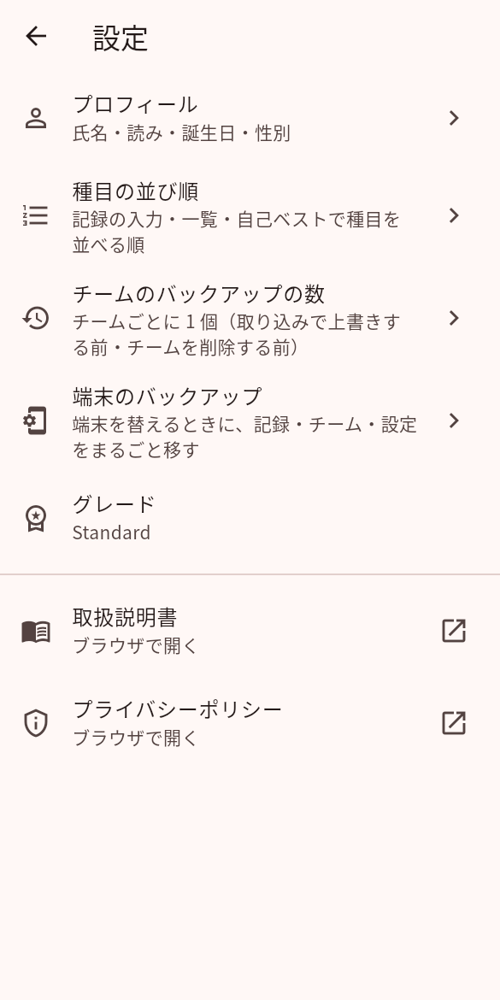 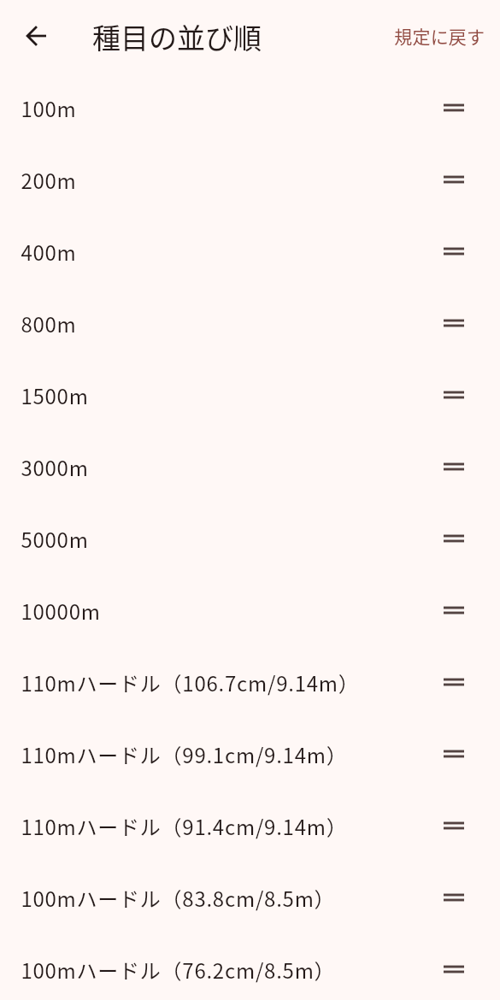

記録の一覧の右上の「︙」→［設定］で開く。

- ［プロフィール］: 自分の氏名・読み・誕生日・性別を修正
- ［種目の並び順］: アプリの中で種目を並べる順（記録の入力・一覧・自己ベスト）。規定は競技規則の順。
  右の取っ手をつまんで上下に動かすと、その場で保存される。右上の［規定に戻す］で競技規則の順に戻る。
  追加した種目（[6 章](#6-追加種目)）も並ぶ（規定では標準の種目の後ろ）
- ［チームのバックアップの数］: チームのデータを取り込んで上書きする前・チームを削除する前に残す数（チームごと。規定 1・0〜20。0 なら残さない）。戻し方は [13 章](#13-チームを戻す削除する)
- ［端末のバックアップ］: 端末を替えるとき（下の「端末のバックアップ」）
- ［グレード］: いまのグレード（下の「グレード」）
- ［取扱説明書］［プライバシーポリシー］: ブラウザで開く（この取扱説明書と、アプリが扱う情報の説明。インターネットにつながっていないと開けない）
- ［追加種目］（[6 章](#6-追加種目)）［PCで編集（CSV）］（[7 章](#7-pcで編集csv)）は、設定の中ではなく、記録の一覧の右上の「︙」に並んでいる

### グレード
{: id="グレード"}

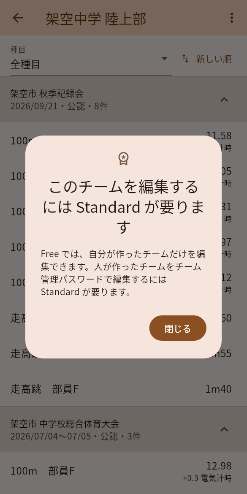

グレードは **Free** と **Standard** の 2 つ。

| | Free | Standard |
|---|---|---|
| 自分の記録・自己ベスト・自分の追加種目・端末のバックアップ | できる | できる |
| チームを作る・届いたチームのデータを見る・自分の記録を送る | できる | できる |
| **自分が作ったチーム**を編集する（チーム管理パスワード） | できる | できる |
| **人が作ったチーム**を編集する | できない | チーム管理パスワードでできる |
| チームデータを配布（配る。自分が作ったチームも）・種目を書き出す | できない | できる |
| チームの記録を CSV で書き出す（自分の記録の CSV・チームの CSV の読み込みは Free でもできる） | できない | できる |

- Free でできないことを押すと「…には Standard が要ります」と出る。**人が作ったチームでは、チーム管理パスワードを聞かずに断る**
- 「自分が作ったチーム」は、プロフィールの自分が作ったチーム（端末のバックアップで新しい端末へ移しても自分のもの）。チームデータを配布しても、受け取った人の端末では「人が作ったチーム」
- **有料（Standard）で増えるのは、管理者がチームのデータを配れること。** チームの中で管理者が 1 人 Standard なら、チームの管理ができる
- Standard にする方法（購入）は、ストアに出すときに用意する

### 端末のバックアップ
{: id="端末のバックアップ"}

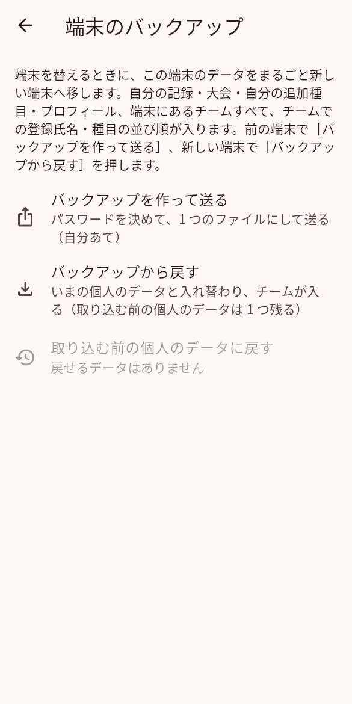 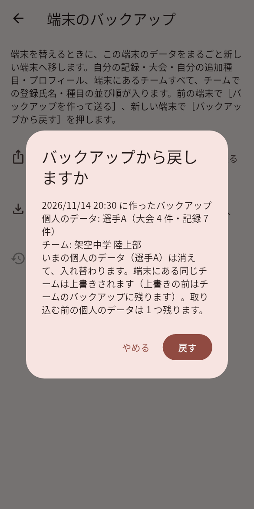

**端末を替えるときに、この端末のデータをまるごと新しい端末へ移す。** 入るのは、自分の記録・大会・自分の追加種目・プロフィール、**端末にあるチームすべて**（自分が作ったチームも、受け取ったチームも）、チームでの登録氏名・自分にあたる部員・種目の並び順・チームのバックアップの数。新しい端末でも「自分が作ったチーム」を自分のものとして編集できる（Free でも）。

1. 前の端末で、設定 →［端末のバックアップ］→［バックアップを作って送る］。パスワード（4 文字以上）を 2 回入れて［送る］と、スマホの共有の画面が開く（ファイルは `<氏名> のバックアップ.tafbackup`）。**自分あてのメールなどで送る**（部員の名前や誕生日も入るので、人には送らない）
2. 新しい端末で、はじめにプロフィールを入れてから、設定 →［端末のバックアップ］→［バックアップから戻す］で届いたファイルを選び、パスワードを入れる
3. 「バックアップから戻しますか」に、作った日時・個人のデータ（氏名・大会と記録の数）・チームの名前が出る。［戻す］で、**いまの個人のデータは入れ替わり、チームが入る**

- 新しい端末にもう同じチームがあれば上書きする（上書きの前のチームは [13 章](#バックアップから戻す)で戻せる）。新しい端末で先に作ったチームは消えず、自分が作ったチームのまま
- 取り込む前の個人のデータは 1 つ残り、［取り込む前の個人のデータに戻す］で戻せる
- 中に読めないものがあるファイル・新しい版のアプリで作ったファイルは「取り込めません」と理由が出て、何も変わらない
- Free でもできる（送り先は自分なので、チームを配ることにはならない）

---

# 第 2 部 チームで記録を管理する
{: id="第-2-部-チームで記録を管理する"}

部活などのチームで、部員の記録を集めて、チーム内のランキングを見る。

## 9. チームでの記録のやり取り
{: id="9-チームでの記録のやり取り"}

**チームの記録は、チームを作った人（管理者）の端末にあるものが正。** 部員は自分の記録を管理者へ送り、管理者が確かめてチームにまとめ、
まとめたチームのデータを部員へ配る。データはファイルで受け渡す（メール・SNS・ドライブなど、ふだん使うもので送る）。

<pre class="mermaid">
sequenceDiagram
    participant 管理 as 管理者
    participant 部員 as 部員
    Note over 管理: チームを作る・部員を登録する（11 章）
    管理-&gt;&gt;部員: ① チームデータを配布（.tafteam・配布パスワード）
    Note over 部員: ② チームデータを取り込む（12 章）
    部員-&gt;&gt;管理: ③ 自分の記録を送る（.tafrec）
    Note over 管理: ④ 部員の記録を受け取る（1 件ずつ確かめてチームへ）
    管理-&gt;&gt;部員: ⑤ チームデータを配り直す
    Note over 部員: ⑥ 取り込む（自分にあたる部員に結ばれる）
</pre>

| | 誰が | 何をする | 説明 |
|---|---|---|---|
| ① | 管理者 | チームを作り、部員を登録して、チームデータを配る | [11 章](#11-管理者の操作チームを作って記録をまとめる) |
| ② | 部員 | 届いたチームデータを、配布パスワードで取り込む。チームの記録とランキングが見られる | [12 章](#チームデータを取り込む) |
| ③ | 部員 | 大会のあとなどに、自分の記録を管理者へ送る（チームデータを受け取る前でも送れる） | [12 章](#自分の記録を送る) |
| ④ | 管理者 | 届いた記録を確かめて、チームの記録に入れる | [11 章](#部員の記録を受け取る) |
| ⑤⑥ | 管理者 → 部員 | まとめたチームデータを配り直し、部員が取り込む。以後は ③〜⑥ をくり返す | [11 章](#チームデータを配布)・[12 章](#チームデータを取り込む) |

- リレー・駅伝の記録は部員からは送らず、管理者がチームの記録として入れる（[11 章](#チームの記録を登録)）
- 管理者が持つデータがチームの正なので、部員が自分の端末でチームを削除・戻しても、管理者が配り直せば元に戻る

### 管理者・協力者・部員
{: id="管理者協力者部員"}

| | 誰か | できること |
|---|---|---|
| **管理者** | チームを作った人 | すべて。チーム管理パスワードを決め、忘れても変えられる |
| **協力者** | 記録係など、管理者からチーム管理パスワードを教わった人 | 編集モードに入って、部員・大会・記録を編集し、チームデータを配る |
| **部員** | チームデータを受け取った人 | チームの記録とランキングを見る・自分の記録を送る |

### パスワードは 2 つ
{: id="パスワードは-2-つ"}

| | 何のため | 決める人 | 伝える相手 |
|---|---|---|---|
| **チーム管理パスワード** | チームを編集する（[編集モード](#編集モード)） | 管理者。忘れたら管理者がいつでも変えられる | 協力者 |
| **配布パスワード** | 配られたチームデータを開く | 配る人（管理者・協力者）が、配るたびに決める | 部員 |

- チームデータを取り込んだ部員は、チーム管理パスワードを知らなければ見るだけ
- チームデータを配るのは **Standard だけ**（[8 章「グレード」](#グレード)）

## 10. チーム一覧とチームの画面
{: id="10-チーム一覧とチームの画面"}

管理者・部員のどちらも使う画面。

### チーム一覧
{: id="チーム一覧"}

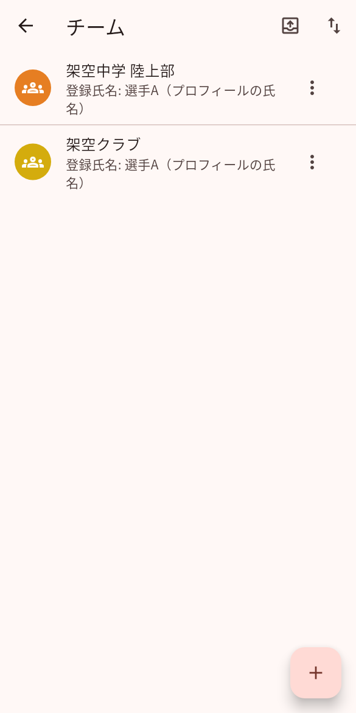 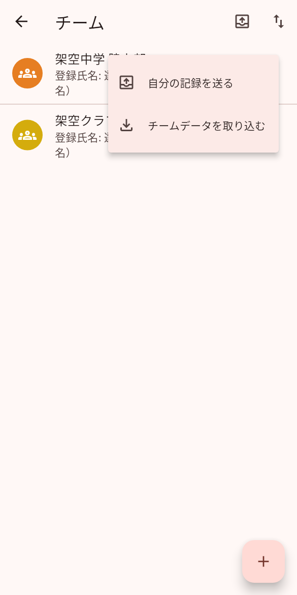

記録の一覧の右上の人たちのボタンで開く。端末にあるチームが、**自分で並べた順**に並ぶ（並べ替えていなければ作った・取り込んだ順）。チームごとに記録のファイルが分かれる。

- **行を押すと、そのチームの画面**（下の「チームの画面」）。見るだけならパスワードは要らない
- 行の左の丸は、そのチームの**テーマカラー**（下の「テーマカラー」）
- 行の下の「登録氏名」は、**このチームでのあなたの名前**（[12 章「登録氏名」](#登録氏名)）。決めていなければプロフィールの氏名
- 行の右のメニュー（︙）は、部員がよく使う［自分の記録を送る］［チームデータを取り込む］だけ（同じものはチームの設定にもある）。ここからの取り込みは**そのチームのデータだけ**を受け付ける（違うチームのファイルなら「取り込めません」と出る）
- 右上は左から［自分の記録を送る］（箱から出る矢印。チームデータをまだ受け取っていないときも送れる）・［並び替え］（上下の矢印）

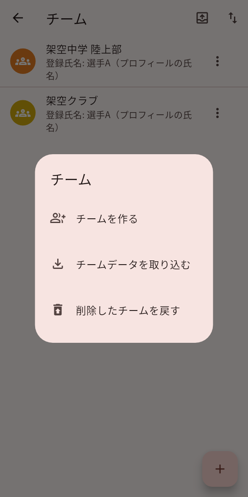

右下の［＋］を押すと、次から選ぶ。

- ［チームを作る］: 管理者になる（[11 章「チームを作る」](#チームを作る)）
- ［チームデータを取り込む］: 管理者から配られたチームデータを取り込む。**はじめてチームに入るときはここから**（[12 章](#チームデータを取り込む)）
- ［削除したチームを戻す］: 削除したチームのバックアップが新しい順に並ぶ（[13 章](#バックアップから戻す)）

### 並び替え
{: id="並び替え"}


右上の［並び替え］（上下の矢印）で並び替えモードになる。行の右の取っ手（＝）をつまんで動かすと、その並びが残る。右上のチェックで終わる。

- **この端末だけの決めごと**。端末のバックアップでは移る

### チームの画面
{: id="チームの画面"}

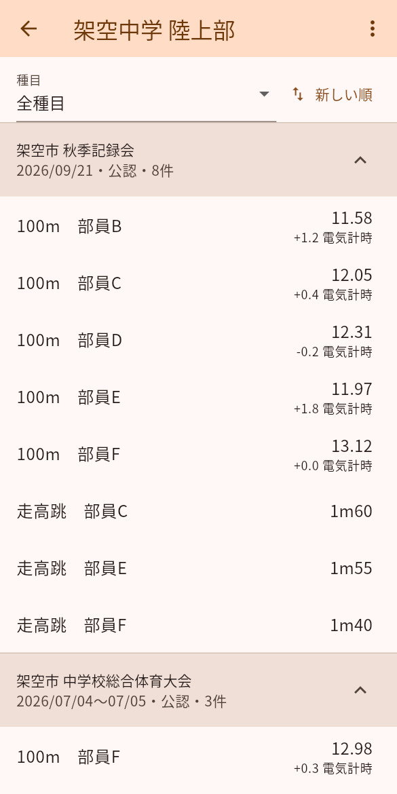 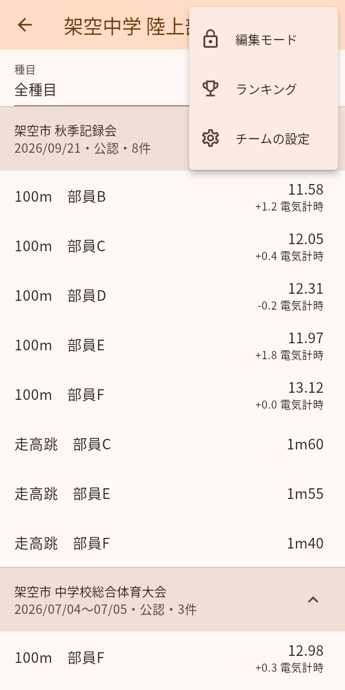

チーム一覧で行を押すと開く。**記録の一覧（[2 章](#2-記録の一覧最初の画面)）と同じ画面で、チームの記録が並ぶ**（大会ごとにまとめる・並び順・種目の絞り込みも同じ）。**画面はそのチームのテーマカラーで出る**（ここから開く記録の入力・部員・大会なども同じ色）。

**右上は「︙」1 つ**で、押すと次が出る。

- ［編集モード］（編集モードのときは［見るだけに戻る］）: [11 章「編集モード」](#編集モード)
- ［ランキング］: 下の「ランキング」
- ［チームの設定］: 下の「チームの設定」

**はじめは見るだけ**: 記録を追加する［＋］も、行を押して修正することも出ない。部員と大会も見るだけ。**自己ベストは個人の画面だけ**（[4 章](#4-自己ベスト)。チームの画面には出ない）。

### チームの設定
{: id="チームの設定"}

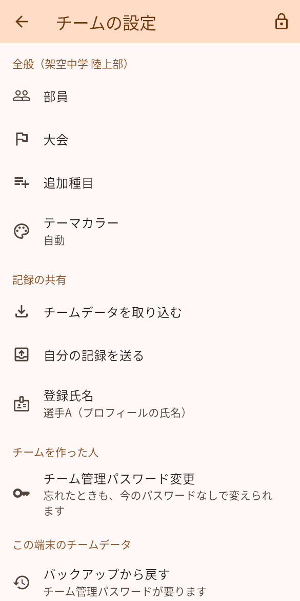 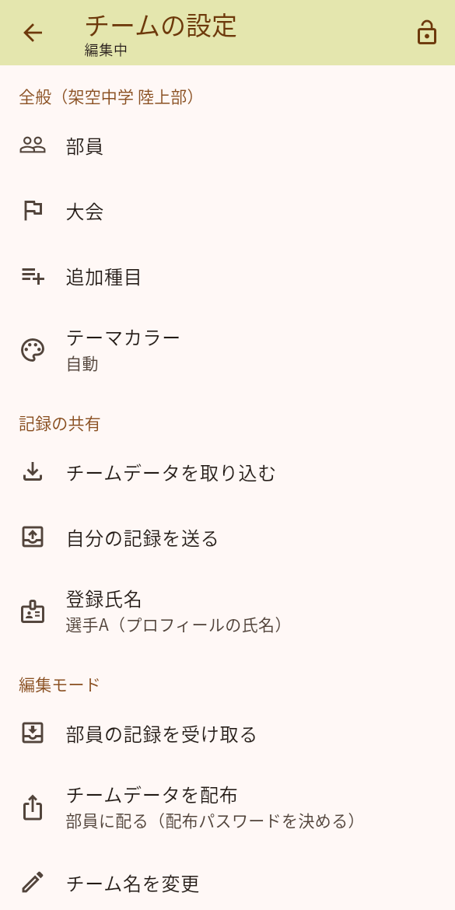

チームの画面の右上の「︙」→［チームの設定］で開く。上から次の順に並ぶ。出る項目は、編集モードか・チームを作った人かで変わる。

| まとまり | 項目 | 出るとき | パスワード |
|---|---|---|---|
| 全般 | [部員](#部員)・[大会](#5-大会の一覧)・[追加種目](#チームの追加種目)・[テーマカラー](#テーマカラー) | いつも（部員・大会・追加種目の追加・修正・削除は編集モード） | 要らない |
| 記録の共有 | [チームデータを取り込む](#チームデータを取り込む)・[自分の記録を送る](#自分の記録を送る)・[登録氏名](#登録氏名)・[この部員は自分ではない](#自分にあたる部員)（結ばれているとき・チームを作った人には出ない） | いつも | 要らない |
| 編集モード | [部員の記録を受け取る](#部員の記録を受け取る)・[チームデータを配布](#チームデータを配布)・[チーム名を変更](#チーム名を変更)・[PCで編集（CSV）](#7-pcで編集csv) | **編集モード**のとき | 編集モードで済み |
| チームを作った人 | [チーム管理パスワード変更](#チーム管理パスワード変更) | **チームを作った人**（編集モードでなくても） | 今のパスワードは要らない |
| この端末のチームデータ | [バックアップから戻す](#バックアップから戻す)・[チームを削除](#チームを削除) | いつも | **チームを作った人はチーム管理パスワード**。ほかの人は確認だけ |

- 設定で変えた名前・テーマカラーは、チームの画面にすぐ出る
- ［チームデータを取り込む］［バックアップから戻す］［チームを削除］は、確かめたあとチームの画面を閉じて、チーム一覧で行う。その間は「取り込み中…」「戻しています…」「削除中…」が出る（終わるまでほかの操作はできない）

### テーマカラー
{: id="テーマカラー"}

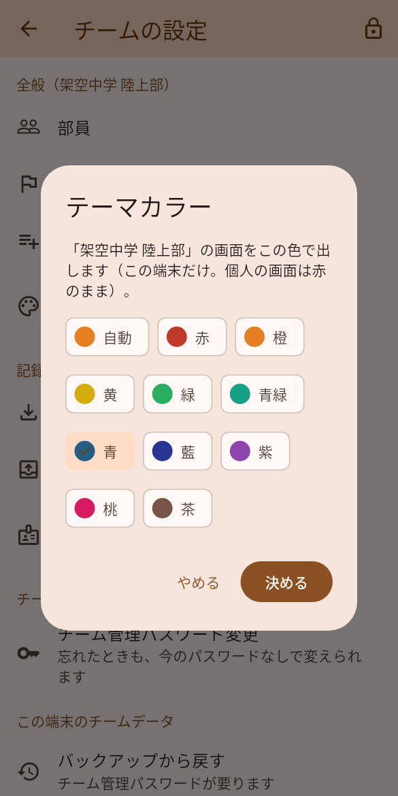

チームの設定の［テーマカラー］で、チームの画面の色を選んで［決める］。チームの画面に入ると、上の帯やボタンがこの色になる（個人の画面は赤）。いま個人の記録を見ているのか、どのチームの記録を見ているのかが分かる。
［自動］にすると、作った・取り込んだ順に色が付く（個人の色の赤は使わない）。

- **この端末だけの決めごと**（チーム管理パスワードは要らない。配ったチームデータでは届かない）。端末のバックアップでは移る
- 編集モードのときは、上の帯が別の色になり「編集中」と出る

### ランキング
{: id="ランキング"}

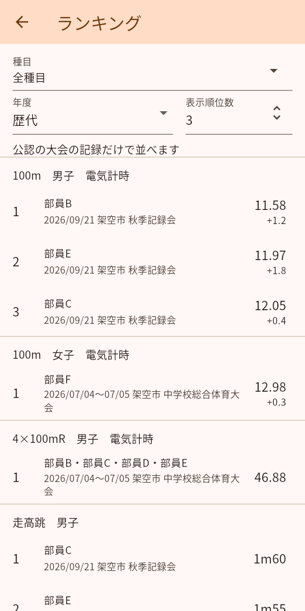 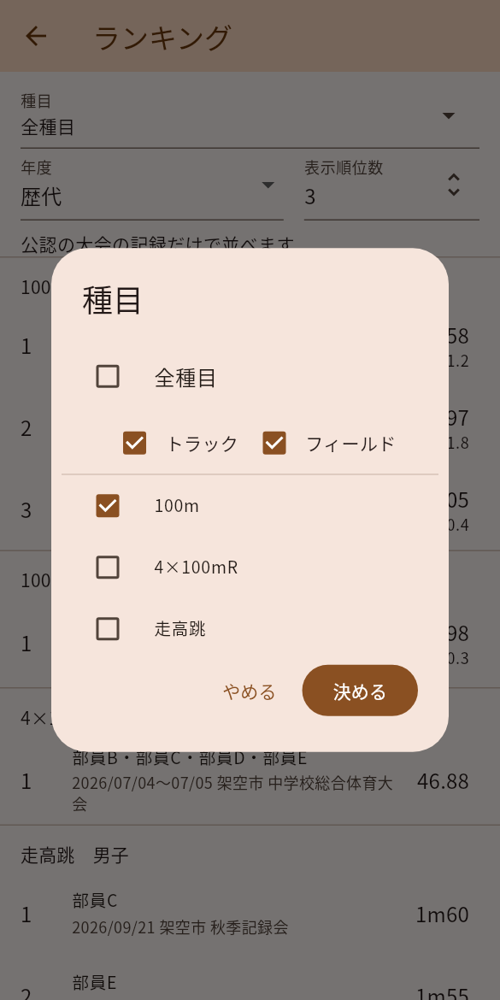

チームの画面の右上の「︙」→［ランキング］。見るだけで開ける（パスワードは要らない）。種目ごと・男女別に、**部員それぞれのいちばん良い記録**を良い順に並べる。
**チームの公認の大会の記録だけ**で並べる（追い風参考・風速の無い記録も入らない。手動計時と電気計時は分ける。[4 章](#4-自己ベスト)と同じ）。

- ［種目］: 押すと選ぶ画面が出る。**［全種目］が既定**で、外すと種目を**いくつでも**選べる（［全種目］に印がある間は、ほかは選べない）。
  上の［トラック］［フィールド］［混成］の印を外すと、その区分の種目が一覧から隠れる（選んだものは外れない）
- ［年度］: **［歴代］が既定**。年度（4月〜翌3月）を選ぶと、その年度の記録だけで並べる
- ［表示順位数］: 何位まで出すか（既定は 1）。**同じ記録は同じ順位**（1位が 2 人なら次は 3位）で、同じ順位の人は全員出る
- **リレーは記録ごとに 1 行**（走者の並び）。走者が全員男子なら男子、全員女子なら女子、混ざれば「混合」
- **駅伝は大会ごと**に並べる（区間の数や距離が大会で違うので、別の大会と比べない）
- あなたにあたる部員は、あなたの登録氏名で出る（[12 章「自分にあたる部員」](#自分にあたる部員)）

## 11. 管理者の操作（チームを作って記録をまとめる）
{: id="11-管理者の操作チームを作って記録をまとめる"}

管理者（と協力者）が、チームを作ってから記録を配るまでの順に並べる。

### チームを作る
{: id="チームを作る"}

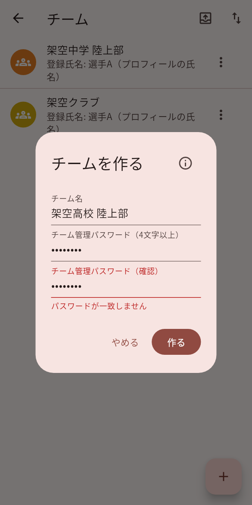 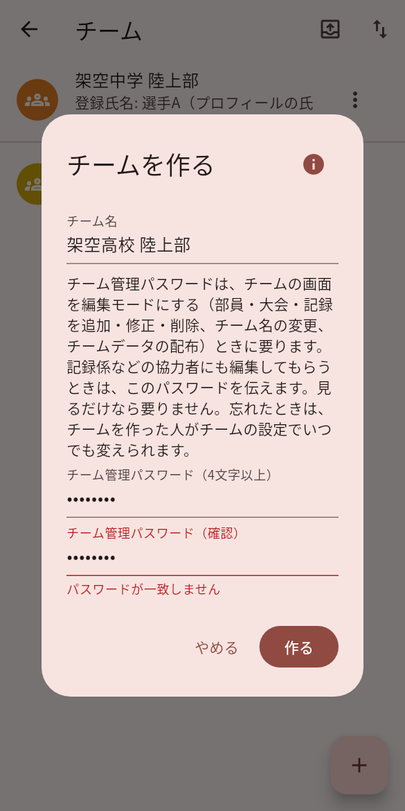

チーム一覧の右下の［＋］→［チームを作る］で、**チーム名**と**チーム管理パスワード**（4 文字以上・確認のためにもう一度）を入れて［作る］。チームを作った人が、そのチームの**管理者**になる。

- 題の横の［i］を押すと、チーム管理パスワードの説明が出る（もう一度押すと隠れる）
- チーム管理パスワードは、**チームの画面を編集モードにするとき**（部員・大会・記録を追加・修正・削除、チーム名の変更、チームデータの配布）に要る。**見るだけなら要らない**
- **記録係などの協力者にも編集してもらうときは、このパスワードを伝える**
- 忘れたときは、**チームを作った人がチームの設定でいつでも変えられる**（今のパスワードは要らない。下の「チーム管理パスワード変更」）
- 確認のパスワードが食い違うと「パスワードが一致しません」と出て、作らない

### 編集モード
{: id="編集モード"}

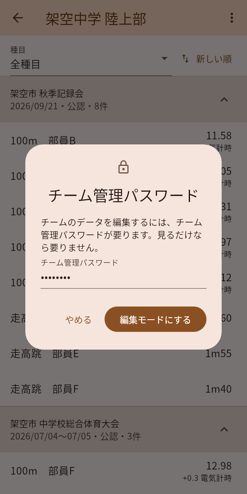 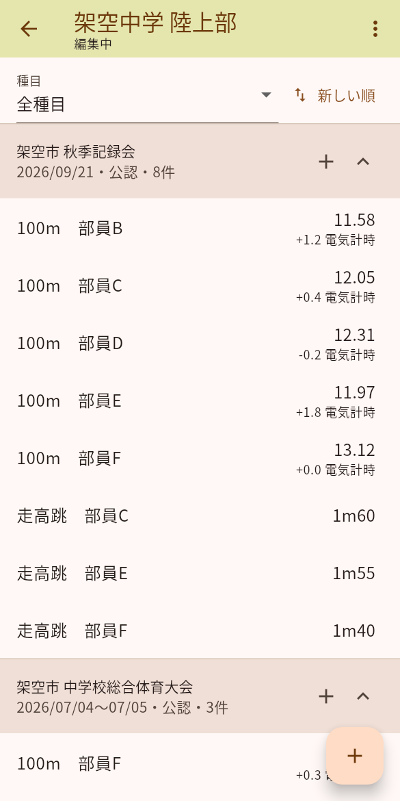 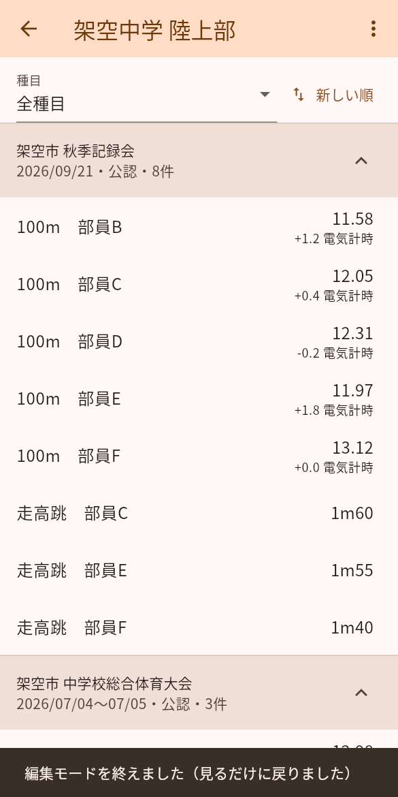

チームの画面の右上の「︙」→［編集モード］を押し、チーム管理パスワードを入れて［編集モードにする］。**上の帯の色が変わって、題の下に「編集中」と出る**。記録・部員・大会を追加・修正・削除するボタンが出る。

- 一度入れば、チームの画面を開いている間（部員・大会の画面も）は聞き直さない
- 「︙」→［見るだけに戻る］で見るだけに戻る（部員・大会・チームの設定の画面では、右上の鍵でも入れる・戻れる）。**チームの画面を閉じても見るだけに戻る**。どちらのときも「編集モードを終えました（見るだけに戻りました）」と出る
- パスワードが違うと「チーム管理パスワードが違います」と出て、入らない
- **Free では、人が作ったチームで［編集モード］を押しても、チーム管理パスワードを聞かずに「このチームを編集するには Standard が要ります」と出る**（[8 章「グレード」](#グレード)）。自分が作ったチームなら Free でも入れる

### 部員
{: id="部員"}

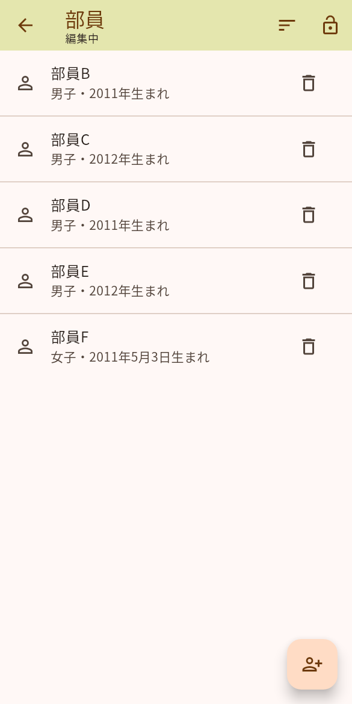 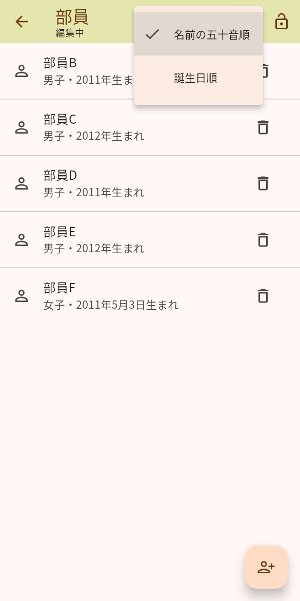 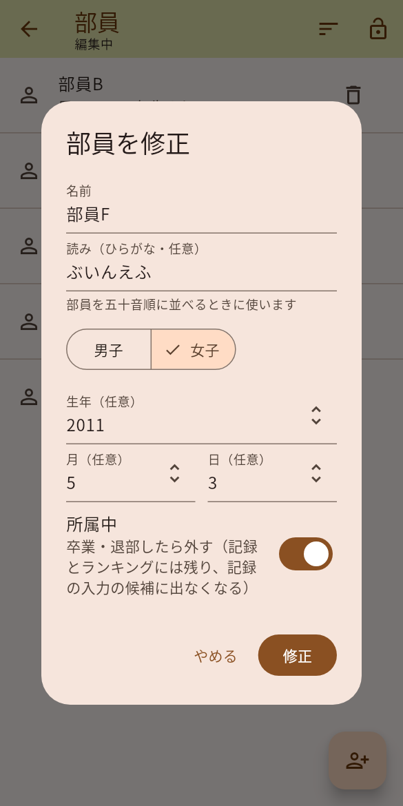

チームの設定の［部員］。部員が並ぶ（読み・性別・誕生日）。**並びは右上で選ぶ**: ［名前の五十音順］（読み。読みが無ければ名前の文字の順）・［誕生日順］（生まれた早い順。分からない部員は後ろ）。所属中の部員が先で、所属外の部員は後ろ。編集モードなら、

- 右下の［＋］で部員を追加する: **名前・読み・性別・生年・月・日（読み・生年・月・日はそれぞれ任意）**。読みはひらがなで入れる（カタカナはひらがなにして残る。ほかの文字は「読みはひらがなで入れてください」と出て［追加］を押せない）。月・日も数字キーかドラムで入れる（**月は生年を入れてから・日は月を入れてから**。生年を削除すると月と日も、月を削除すると日も消える。その月に無い日は「2月に30日はありません」と出る）。生年は数字キー（4 桁）かドラムで
- **名前の先頭に記号（`=` `+` `-` `@` `・` `（` など）は使えない**（「名前の先頭に記号は使えません」と出て［追加］を押せない）。自分の氏名・チームでの登録氏名も同じ
- 行を押すと修正。行のごみ箱で削除。**記録のある部員は削除できない**（件数が出るので、先に記録を削除）
- **卒業・退部した部員は、修正するダイアログの［所属中］を外す。** 一覧の後ろに「所属外」と添えて並び、**記録を登録するときの選手・走者の候補に出なくなる**。記録とランキング（歴代）には残る（その部員の記録を修正するときは、選んである部員として出る）。また戻せる
- 部員の名簿は、記録と一緒に CSV でPC でも修正できる（[7 章](#7-pcで編集csv)）
- 同じ人が別のチームにもいるなら、それぞれのチームで部員として追加
- 名前を修正しても同じ人として扱われる（部員の記録を受け取るときも）
- **あなたにあたる部員は、あなたが決めた登録氏名で見え、「あなた（登録名: …）」と添えて出る**（ほかの人には管理者が登録した名前で見える。[12 章「自分にあたる部員」](#自分にあたる部員)）

### チームの記録を登録
{: id="チームの記録を登録"}

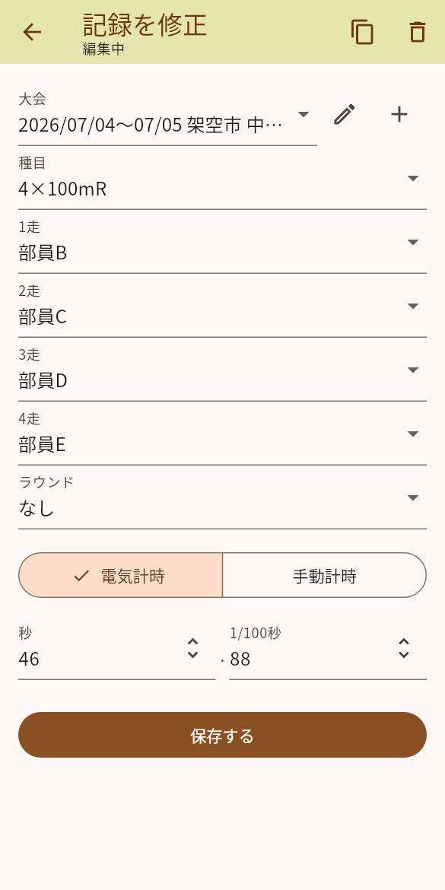

編集モードで右下の［＋］（または大会の見出しの［＋］）。個人の記録の入力（[3 章](#3-記録を登録修正)）と同じ画面に、選手の欄が付く。コピーして登録・大会の追加も 3 章と同じ。

- 1人の種目は［選手］で部員を選ぶ
- リレーは［1走］〜［4走］のそれぞれに部員を選ぶ。駅伝は［1区］から始まり、［区間を追加］で増やす（［最後の区間を外す］で減らす）
- 同じ選手を 2 回選ぶと「同じ選手が2回走っています」と出て、保存しない
- **チームの大会は公認だけ**: 大会を追加・修正するときに種類は選べず、公認になる（チームの記録は公認の記録だけ）
- 修正するときは、選手・走者も修正できる
- 大会の一覧はチームの設定の［大会］（[5 章](#5-大会の一覧)と同じ画面）

### チームの追加種目
{: id="チームの追加種目"}

チームの設定の［追加種目］。チームの記録に入れる種目のうち、標準の一覧に無いものを追加する。画面と欄は [6 章](#6-追加種目)と同じで、
**追加・修正・削除するのは編集モードのときだけ**。チームの記録の入力には、標準の種目とチームの追加種目だけが出る（自分の追加種目は出ない）。

- チームの追加種目は、チームデータと一緒に部員へ届く。種目の定義だけを書き出して配ることもできる（[6 章「種目を書き出す・読み込む」](#種目を書き出す読み込むアドオン)）

### 部員の記録を受け取る
{: id="部員の記録を受け取る"}

 

編集モードで、チームの設定の［部員の記録を受け取る］。部員から届いたファイル（`.tafrec`。[12 章「自分の記録を送る」](#自分の記録を送る)）を選ぶと、**記録を 1 件ずつ確かめて**チームの記録に入れる画面が出る。

- **送り主**: 名前・読み・性別・誕生日。**どの部員の記録か**を決める
  - 前にまとめた部員（または配ったチームのデータを受け取った部員）なら、**自動で決まる**（「部員の ID で決まりました」。名前が変わっていても同じ人）
    - ただし**送られた名前が部員の名前と違うとき**は「送られた名前「…」と違います」と出て、ほかの部員を選び直せる（同じ人として扱ってよいか確かめるため）
    - **名前が同じでも、［別の部員を選ぶ（取り違えていたとき）］でいつでも選び直せる**（同じ名前の部員を取り違えてまとめていたとき。部員から「この部員は自分ではない」と言われたら、ここで正しい部員を選ぶ）。選ぶと、決まった部員と同じ名前の部員が候補に並ぶ。次からは選んだ部員に決まる
    - 決まっていた部員がもういない（削除したなど）ときは、どの部員の記録かを選ぶ（部員として追加することはできない）
    - **部員の名前は、部員の画面（編集モード）でいつでも修正できる**（修正しても同じ人として扱われる）
  - はじめての部員は名前で探す。名前が同じ部員・近い名前の部員（空白・全角と半角・カタカナとひらがなの違いを揃えて比べる）が候補に出るので、選ぶ。**候補には性別・誕生日も出る**ので、同じ名前の部員は送り主の誕生日と見比べる。ほかの部員は［ほかの部員を選ぶ］から
  - 選んだ部員の名前が送られた名前と違えば、**チーム記録に出す名前**を「登録した名前」と「送られた名前」から選ぶ（送られた名前にすると、読みが送られていれば読みも送られた読みになる。送られていなければ前の読みのままなので、部員の画面で確かめる）
  - どの部員にも当たらなければ［部員として追加］（送られた名前・読み・性別・誕生日で追加）
- **大会**: 名前と日付が同じチームの大会にまとめる。無ければ公認の大会として追加。**期間が 1 日でも重なる大会**（名前や日付が違っても）があれば、まとめる先を選べる
- **記録**: チームに入れる記録に印を付ける（はじめは印なし。［すべて選ぶ］もある）
  - **もうチームに入っている記録**（同じ部員・種目・大会・ラウンド・記録・風速・計時）と**チームに無い種目の記録**は、わけが出て選べない
  - **確認の添付**があれば、［出典を開く（行き先）］でブラウザが開き（**押す前に行き先が見える**。http・https のほかは開かない）、写真は押すと大きく出る。**添付はチームの記録には残らない**
- ［チームに入れる］で、追加する部員・修正する名前・追加する大会・入れる記録の数を確かめてから入れる
- 別のチームあてのファイル・部員の記録でないファイル・**書き換えられたファイル**（出典が http・https でない・写真が 6 枚以上や 10 MB を超える）は「取り込めません」と理由が出る
- 入れられなかったとき（画面を開いている間に部員を削除したなど）は「チームに入れられませんでした」と出る。チームは変わらない
- まとめたら、チームのデータを配り直す（下の「チームデータを配布」）。部員が取り込むと、**部員の端末で自分がその部員に結ばれる**

### チームデータを配布
{: id="チームデータを配布"}


まとめたチームのデータ（部員・大会・記録・チームの追加種目）を部員へ配る。

- 編集モードで、チームの設定の［チームデータを配布］（**Standard だけ**。[8 章「グレード」](#グレード)）。**配布パスワード**（受け取った部員がファイルを開くときのパスワード。4 文字以上）を 2 回入れて［配布］と、スマホの共有の画面が開く（ファイルは `<チーム名>.tafteam`）
- ファイルは配布パスワードで暗号化されるので、パスワードを知らない人は中を読めない
- 配布パスワードは**部員に伝えるもの**。チーム管理パスワードとは別のものにする（同じにすると、部員が編集モードに入れてしまう）。**ファイルとは別の方法（口頭など）で伝える**
- **部員の名前と誕生日が入るので、送り先はチームの中だけにする**
- 部員の取り込み方は [12 章「チームデータを取り込む」](#チームデータを取り込む)

### チーム名を変更
{: id="チーム名を変更"}


編集モードで、チームの設定の［チーム名を変更］。新しいチーム名を入れて［変更］（編集モードに入るときにパスワードを確かめているので、もう聞かない）。

### チーム管理パスワード変更
{: id="チーム管理パスワード変更"}


**チームを作った人だけ**、チームの設定に［チーム管理パスワード変更］が出る（編集モードでなくても）。新しいパスワードを 2 回入れて［変更］。**今のパスワードは要らない**ので、忘れたときにも変えられる。

- 協力者の端末のパスワードは、チームデータを配り直すと新しいものに替わる

## 12. 部員の操作（チームに入って記録を送る）
{: id="12-部員の操作チームに入って記録を送る"}

管理者からチームデータを受け取ってから、自分の記録を送るまでの順に並べる。

### チームデータを取り込む
{: id="チームデータを取り込む"}

 

チーム一覧の右下の［＋］→［チームデータを取り込む］（行のメニュー・チームの設定からも）で、管理者から届いたファイル（`.tafteam`）を選び、**配布パスワード**を入れる（違うと「配布パスワードが違います」）。

- 端末にまだ無いチームなら「このチームを取り込みますか」。［取り込む］で一覧に追加される
- **同じチームがもうあれば「端末にあるこのチームを上書きしますか」と、今と届いたデータの部員・記録の数が並ぶ。** ［上書きする］と、端末のそのチームは届いたデータに置き換わる（今の形はバックアップに残る。自分の記録は変わらない）。古いデータで上書きしないよう、数を見て確かめる
- 同じチームかどうかはチーム名では決まらない（同じ名前の別のチームは上書きしない）
- チームデータでないファイル・自分の記録のファイル・新しい版のアプリで作ったファイルは「取り込めません」と理由が出る
- 取り込むと、**チームの追加種目が自分の追加種目の画面にも「チームの追加種目」として入り**、自分の記録でも使える（名前も形も同じ自分の追加種目があれば自動で紐づける。名前だけ同じなら知らせる。[6 章](#6-追加種目)）
- 取り込んだチームも、編集するにはチーム管理パスワードが要る（配布パスワードとは別）

### 自分の記録を取り込む
{: id="自分の記録を取り込む"}


**チームデータに、個人の記録に無いあなたの記録があれば、取り込んだあとに「自分の記録を取り込みますか」が出る。** どの部員の記録か（名前・性別・誕生日）も出る。取り込みたくない記録は印を外して［N 件を取り込む］（はじめはすべてに印）。無ければ何も出ない。

- **その部員があなたでなければ、［この部員は自分ではない］**（下の「自分にあたる部員」）
- あなたの記録は、**自分にあたる部員**の記録と、その部員が走ったリレー・駅伝の記録（個人では自分の走順・区間として入る）
- 個人にもうある記録は出ない。同じかどうかは**大会の日・種目・記録**で見る（大会の期間が 1 日でも重なり、種目と記録が同じなら同じ記録。大会の名前は違ってもよい）
- 入れる大会: 個人の記録に期間の重なる**公認の**大会があれば（練習・非公認の大会には入れない。自己ベストから消えないように）、**その大会（名前も個人のもの）**に入れる。無ければチームの大会の名前・日付で個人に大会を追加する
- 個人の記録が PCで編集中（[7 章](#pcで編集中)）なら取り込まない（読み込んでから、チームデータを取り込み直すと出る）

### 自分にあたる部員
{: id="自分にあたる部員"}

**どの部員があなたかは、管理者が決める**（あなたが選ぶ画面は無い）。あなたが送った記録を管理者がまとめると（[11 章「部員の記録を受け取る」](#部員の記録を受け取る)）、配り直されたチームデータを取り込んだときに、あなたはその部員に**自動で結ばれる**。

- 結ばれると、チームの画面であなたの記録が**あなたの登録氏名**で見える（ほかの人には管理者が登録した名前で見える）。次からは記録を送るときに名前などを送らなくてよい
- まだ記録を送っていなければ結ばれない（それでも取り込める）
- **管理者が別の人（同じ名前の部員など）に結んでしまったとき**:
  - 管理者が気づいて［別の部員を選ぶ］で選び直し、チームデータを配り直せば、**取り込んだときに正しい部員へ自動で結び直す**（あなたは何もしなくてよい）
  - あなたが気づいたら、［この部員は自分ではない］を押す。チームの設定の「記録の共有」（結ばれている部員の名前・性別・誕生日と並ぶ）か、上の「自分の記録を取り込みますか」にある。結びつきが外れ、次に取り込んでもその部員には結ばれない。**チームの管理者に伝えて**、あなたの記録をもう一度まとめてもらう
  - 押すと「この部員との結びつきを外しますか」と確かめる（押し間違えると戻せないため）。外したあとで戻すには、チームを削除して取り込み直す
  - ［この部員は自分ではない］は、**チームを作った人（管理者）には出ない**（紐づけを決める側のため）

### 登録氏名
{: id="登録氏名"}


チームの設定の［登録氏名］。このチームに記録を送るときの、あなたの名前を決める（チームごとに違ってよい）。**チーム管理パスワードは要らない**。
空にして［決める］と、プロフィールの氏名に戻る。**打った名前はそのまま残る**ので、プロフィールの氏名と同じ文字を入れておくと、あとで氏名を修正してもこのチームでは変わらない（旧姓のままにしたいときなど）。

### 自分の記録を送る
{: id="自分の記録を送る"}

 

自分の記録をチームの管理者へ送る。管理者が確かめてチームの記録にまとめる（[11 章「部員の記録を受け取る」](#部員の記録を受け取る)）。

- チーム一覧の右上の［自分の記録を送る］、行のメニューの［自分の記録を送る］、チームの設定の［自分の記録を送る］のどれかで開く。［送り先のチーム］を選ぶ（**チームデータをまだ受け取っていなければ**「チームのデータをまだ受け取っていないチーム」）
- **送る名前**は、このチームでの登録氏名（決めていなければプロフィールの氏名）。性別と誕生日も一緒に送る。**読み**（プロフィール）は、送る名前がプロフィールの氏名と同じときだけ送る（登録氏名を旧姓などにしていると、読みが合わないため）
  - **自分にあたる部員に結ばれていれば、名前・性別・誕生日は送らない**（「部員の ID で送ります」と出る）
- **［期間の始め］〜［期間の終わり］**（年月）を選ぶと、その間に始まった大会の記録が**大会ごと**に並ぶ。はじめは**今年度**（4 月〜今月）
- **送れる記録だけが並び、はじめは全部に印が付いている**。送らない記録は印を外す。大会の見出しの印で、その大会の記録をまとめて外す・付ける
  - **チームにもう入っている記録は並ばない**（配られたチームデータに、自分の記録として同じものがあるとき。数は下の「送らない記録」に出る）
  - 送るのは**公認の大会の、1 人の種目の記録だけ**（チームの記録は公認だけ）
  - **リレー・駅伝の記録は送らない**（チームのリレー・駅伝は管理者が入れる）
  - **チームに無い種目の記録は送らない**。自分の追加種目でも、そのチームの追加種目に紐づけていれば（[6 章](#チームの追加種目を紐づける)）、チームの追加種目として送る
  - 送らない記録は、わけごとの数が下に出る
- 記録の右のクリップで**確認の添付**を付けられる（任意）: **出典の URL**（公式記録のページなど。http:// か https:// で始まるもの）と**写真**（記録の掲示を撮ったものなど。5 枚まで・**1 枚 10 MB まで**。大きすぎる写真は付かず、そう出る）。管理者が記録を確かめる材料で、チームの記録には残らない
- ［送る］で、スマホの共有の画面が開く（ファイルは `<送る名前>_<チーム名>.tafrec`）。**このファイルは暗号化しない**ので、送り先は管理者だけにする

## 13. チームを戻す・削除する
{: id="13-チームを戻す削除する"}

### バックアップから戻す
{: id="バックアップから戻す"}


取り込みで上書きする前と、チームを削除する前に、そのチームのデータが端末に**バックアップ**として残る。

- チームの設定の［バックアップから戻す］で、そのチームのバックアップが日時・わけ（取り込みの前／削除する前／戻す前）つきで新しい順に並ぶ。選んで［戻す］
  - **チームを作った人は、チーム管理パスワードを入れる**。ほかの人は確認だけ
  - そのバックアップに置き換わる（**戻す前の今の形もバックアップに残る**ので、戻し直せる）
- 削除したチームは、チーム一覧の［＋］→［削除したチームを戻す］から。選んで［戻す］と、チーム一覧に戻る
- 残す数は、設定の［チームのバックアップの数］で決める（**チームごと・規定 1**・0 にすると残さない。減らすと古いものから消える。[8 章](#8-設定)）

### チームを削除
{: id="チームを削除"}


チームの設定の［チームを削除］。**この端末のチームの部員と記録がすべて消える**（削除する前の形はバックアップに残る）。

- **チームを作った人は、チーム管理パスワードを入れて［削除］**（操作ミスを防ぐため）
- ほかの人（部員・協力者）は、確認のメッセージだけで削除できる。管理者にチームデータを配ってもらえば、また取り込める
